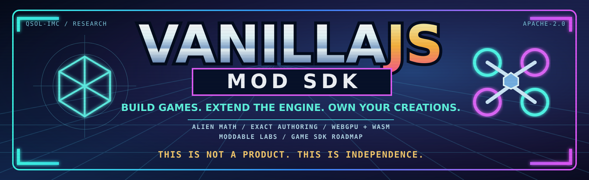
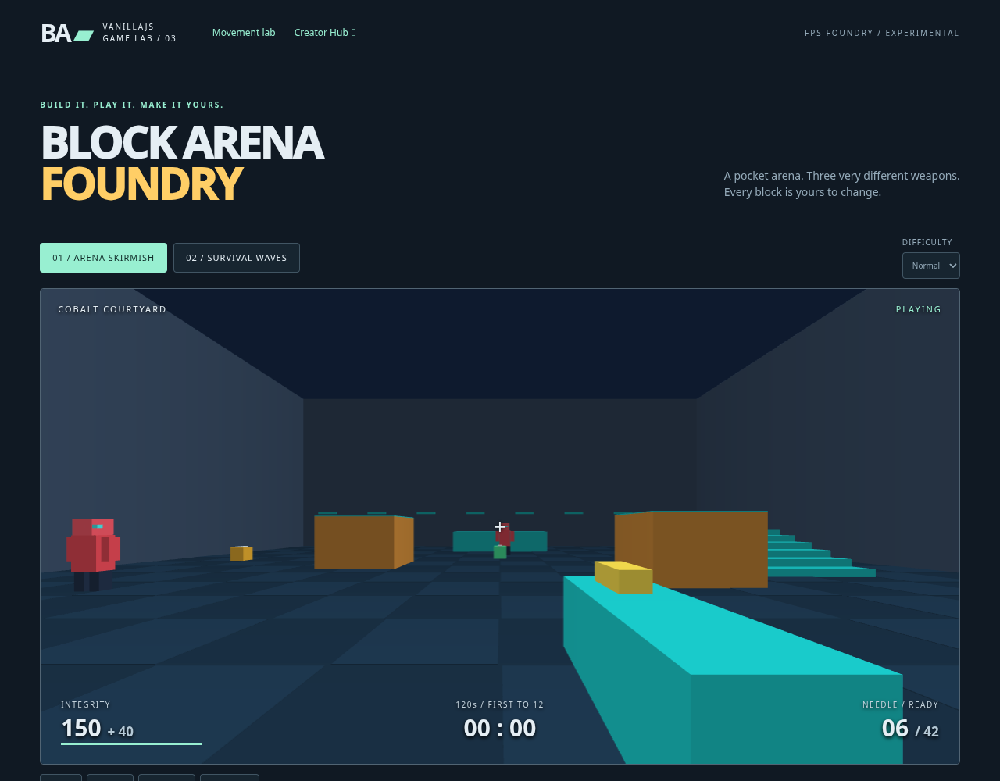

<p align="center">
  
</p>

# VANILLAJS 👽

**Build games. Extend the engine. Own your creations.**

A native JavaScript game-engine workshop: playable browser games, reusable
simulation modules, visual authoring tools, procedural sound and exact-math
experiments. Open a lab, find a mechanic you like, change its data, then take
the public modules into a game of your own.

**This is not a product. This is INDEPENDENCE.**

**Latest published release:** [v2.2.0 — The Arcade Foundry](https://github.com/QSOLKCB/VANILLAJS/releases/tag/v2.2.0), 15 November 2026.
**Proposed next release:** [v2.3.0 — The FPS Foundry](docs/FPS_2_3_0_DRAFT.md).
The FPS Foundry is implemented in this branch; its release has not been published.

| In this source tree | What you can do |
| --- | --- |
| **59 experimental modules** | Compose movement, collision, combat, navigation, rendering, sound and validated content |
| **42 registered recipes** | Learn from playable games, focused mechanics and creator workflows |
| **2 research experiments** | Inspect ARCH OMI and E8 geometry with their attribution and mathematical limits |
| **Native browser runtime** | Run ES modules, WebGL, Canvas, SVG and Web Audio without an engine framework or CDN |
| **Offline packages** | Build a bounded static site with verified asset hashes and a generated service worker |

[**Play the published labs**](https://qsolkcb.github.io/VANILLAJS/) ·
[**Start creating**](https://qsolkcb.github.io/VANILLAJS/demos/creator-hub/index.html) ·
[Run locally](#run-the-labs) · [Build a game](#build-a-game) ·
[Module catalogue](#modules) · [Verification](#development-and-verification) ·
[Releases](#published-milestones)

## Welcome to the foundry

Fly through a conduit. Defend a warship. Build a football club. Chase a suspect
along a neon highway. Shape an arena, tune a weapon and see what happens when a
bot finds another route around your cover. These labs make the engine's ideas
playable, and leave the implementation open for you to inspect.

- **Start with something that moves.** Each lab demonstrates a concrete game or
  mechanic; the Creator Hub helps you choose a starting point.
- **Keep the parts you need.** Public modules have declared, one-way dependencies.
  World fiction, match rules, campaigns and interfaces stay with their games.
- **Author data you can keep.** Download projects, arena packs, tracks, campaigns,
  replays and original WAV files through the tools that support those formats.
- **Make changes with feedback.** Bounded schemas, transactional imports and
  visible diagnostics help catch mistakes before replacing an accepted session.
- **Know what was tested.** Numerical contracts, source pins, independent checks
  and recorded evidence accompany the systems that make stronger claims.

> **Play the game. Own the game.** No accounts, advertising SDKs, premium
> currencies, paid weapon unlocks, loot boxes, tracking or entitlement checks.

**QSOL–IMC motto:** Make amazing alien tech and put it under an Apache 2.0 license. 🛸

## Next up: The FPS Foundry

**[Block Arena Foundry](demos/block-arena-lab/index.html)** is an original blocky
3D FPS and a practical arena-building workshop. It extends the existing FPS
character, collision, weapon, projectile, navigation and rendering facilities.
Run this branch locally to try it; the published site gains it after an approved
merge and Pages deployment.



### Build your advantage

| Play | The challenge |
| --- | --- |
| **Arena Skirmish** | Fight offline bots, manage ammunition, respawn and race to the score or time limit |
| **Survival Waves** | Clear escalating enemy rosters with finite supplies and no player respawn |
| **Cobalt Courtyard** | Use the central cover, open lanes and raised deck |
| **Violet Switchyard** | Work around offset corridors and a second original block-built layout |

Three weapons give the same arena three different rhythms:

| Weapon | Behaviour |
| --- | --- |
| **Needle** | Precise semi-automatic hitscan, headshots, optional scope and bounded penetration |
| **Pulse** | Sustained automatic fire with configurable spread, recoil and reload timing |
| **Orb** | A finite-speed projectile with wall collision, occluded splash and self-damage |

Bots patrol, detect, react, pursue, strafe and seek cover. Their shots use the
same collision and damage systems as yours. Keyboard/mouse, Pointer Lock,
standard gamepad and touch controls feed one fixed-tick input path; settings
include sensitivity, inversion and fullscreen presentation.

### Make the next arena yours

Load a starter, place cover, move spawns, add supplies and tune weapon fields.
Validate the draft and immediately play it. Advanced inert JSON exposes the
palette, geometry, rules, bot types, difficulty and wave composition. Rejected
imports preserve your accepted pack and current match.

Export the arena or keep a complete source-bound input replay. Verification
reruns the journal and compares the final state exactly **within the same source
and JavaScript runtime**. This is Float64 simulation with AABB bodies and stair
ramps; cross-engine bit equality and general voxel physics are not claimed.

[**Build Your First Blocky FPS**](docs/BUILD_YOUR_FIRST_BLOCKY_FPS.md) ·
[Combat and pack contracts](docs/FPS_FOUNDATION_001.md) ·
[Public-module example](api/fps/example.js) ·
[Pinned donor review](docs/FPS_DONOR_REVIEW.md) ·
[Executed development evidence](evidence/FPS-FOUNDATION-001/README.md)

## Find your next lab

The published links open the deployed collection. Source paths identify the
same entrypoints when served locally. The existing FPS movement lab remains
available alongside the new Block Arena workshop.

### Games and worlds

| Lab | Get into it | Contracts and creator material |
| --- | --- | --- |
| [Arcade Combat Foundry](https://qsolkcb.github.io/VANILLAJS/demos/arcade-combat-lab/index.html) | **Iron Meridian** run-and-gun and **Ring // Zero** arena brawler share integer 2D combat, editable packs and complete replays | [Arcade foundation](docs/ARCADE_FOUNDATION_001.md) |
| [SKYGUARD](https://qsolkcb.github.io/VANILLAJS/demos/skyguard-lab/index.html) | Take the watch aboard **DDG Resolute**: autocannon, flak, guided interceptors, charged railgun and station refits | [Spooky integration](docs/SKYGUARD_INTEGRATION.md) |
| [Pursuit Lab](https://qsolkcb.github.io/VANILLAJS/demos/pursuit-lab/index.html) | **Highway Intercept**: five timed pursuits, traffic, bumper contacts, three turbos per case and an original soundtrack | [Outruin integration](docs/OUTRUIN_INTEGRATION.md) |
| [Touchline](https://qsolkcb.github.io/VANILLAJS/demos/football-manager/index.html) | Manage one of eight SOCCERWEB clubs through a 56-fixture league; make live substitutions and tactical changes | [Football SDK](docs/FOOTBALL_SDK.md) · [Starter pack](demos/football-manager/starter.json) |
| [SubHunt](https://qsolkcb.github.io/VANILLAJS/demos/subhunt-lab/index.html) | Fleet Hunt and living-toy Pond Panic, difficulty choices, power-ups and tick-driven music | [SubHunt integration](docs/SUBHUNT_INTEGRATION.md) |
| [Racing & Track Foundry](https://qsolkcb.github.io/VANILLAJS/demos/racing-lab/index.html) | Retro traffic, circuits, derby, ball and stunt modes; Scenic Tour, Coastal Sprint and an editable road/circuit workshop | [Racing](docs/RACING_002.md) · [Track authoring](docs/RACING_002B.md) |
| [Ternary Reach](https://qsolkcb.github.io/VANILLAJS/demos/4x-game-lab/index.html) | Explore a seeded star sector, settle colonies, develop an exact economy and command fleets | [4X Game Lab](docs/4X_GAME_LAB.md) |
| [VOIDWARD](https://qsolkcb.github.io/VANILLAJS/demos/4x-game-lab/voidward/index.html) | Eight moddable campaigns, empire choices, fleet orders, ship designs, diplomacy and staged objectives | [Player guide](demos/4x-game-lab/voidward/guide.html) · [Campaign workflow](docs/VOIDWARD_WORKFLOW.md) |
| [The Clockwork Vault](https://qsolkcb.github.io/VANILLAJS/demos/clockwork-vault/index.html) | Open six OMI seals, operate mechanisms and escape an original first-person chamber | [Game and evidence](docs/CLOCKWORK_VAULT.md) |

### Mechanics you can take apart

| Lab | What it demonstrates |
| --- | --- |
| [Flight](https://qsolkcb.github.io/VANILLAJS/) | Assisted and inertial 6DOF flight, mouse look, gamepads and fixed-step simulation |
| [FPS movement](https://qsolkcb.github.io/VANILLAJS/demos/fps-lab/index.html) | Six recipes: footwork, live range, low passage, moving-target tracking, clearance lift and shuttle run |
| [Interaction](https://qsolkcb.github.io/VANILLAJS/demos/interaction-lab/index.html) | Swept projectiles, shields and inspectable conditional reaction outcomes |
| [RTS](https://qsolkcb.github.io/VANILLAJS/demos/rts-lab/index.html) | Route planning, squad orders, flow convoys and two-exit evacuation |
| [2D Foundry](https://qsolkcb.github.io/VANILLAJS/demos/2d-lab/index.html) | Integer-tick movement, local PCM sound and bounded ternary document encoding |
| [Integer Foundry](https://qsolkcb.github.io/VANILLAJS/demos/integer-foundry/index.html) | Checked Q16.16 movement, gantries, power cells and full-state replay |
| [Bullet Time](https://qsolkcb.github.io/VANILLAJS/demos/bullet-time-lab/index.html) | Separate time domains and explicitly bounded slow-motion mechanics |
| [ARCADE](https://qsolkcb.github.io/VANILLAJS/demos/arcade-lab/index.html) | Original bounded arcade recipes and invariant presentation reuse |
| [Kinetic Foundry](https://qsolkcb.github.io/VANILLAJS/demos/gpu-lab/index.html) | Procedural sculptures, a CPU baseline and optional WebGPU/WASM paths |
| [Orbital Proving Ground](https://qsolkcb.github.io/VANILLAJS/demos/space-lab/index.html) | Navigation, docking, broadsides and classical Newtonian orbit trails |

### Create, compose and investigate

| Tool or experiment | What you can make or inspect |
| --- | --- |
| [Creator Hub](https://qsolkcb.github.io/VANILLAJS/demos/creator-hub/index.html) | Guided starting points, practical genre workflows and packaging help |
| [Visual Workbench](https://qsolkcb.github.io/VANILLAJS/demos/editor/index.html) | Scene starters, components, transforms, local assets, prefabs, Play mode and export |
| [Soundtrack Lab](https://qsolkcb.github.io/VANILLAJS/demos/soundtrack-lab/index.html) | Original cue recipes, declared mappings, listening and WAV/recipe/score export |
| [ALIEN Course Foundry](https://qsolkcb.github.io/VANILLAJS/demos/alien-course-lab/index.html) | Decimal-string authoring, explicit Q16.16 conversion and swept gate crossings |
| [ALIEN Circuit Foundry](https://qsolkcb.github.io/VANILLAJS/demos/circuit-mod-lab/index.html) | Cardinal X/Z checkpoints, ordered laps and local course packs |
| [Ternary Constellation](https://qsolkcb.github.io/VANILLAJS/demos/quantum-game-lab/index.html) | Exact GF(3) puzzles, state graphs, symbolic scores and bounded reference audio |
| [Graph & Spectral Lab](https://qsolkcb.github.io/VANILLAJS/demos/graph-lab/index.html) | Graph traversal and exact adjacency characteristic polynomials |
| [OMI Lab](https://qsolkcb.github.io/VANILLAJS/demos/omi-lab/index.html) | Brian Thorne's attributed ARCH OMI delta law and exhaustive finite observations |
| [The Brass Engine](https://qsolkcb.github.io/VANILLAJS/demos/ancient-machine/index.html) | A fictional mechanical presentation of the OMI calculation, with partial-step replay |

## Run the labs

Clone the source and serve it with any static HTTP server:

```sh
git clone https://github.com/QSOLKCB/VANILLAJS.git
cd VANILLAJS
python3 -m http.server 8000 --bind 127.0.0.1
```

Open **http://127.0.0.1:8000/**. For the FPS implementation branch, check out
`feat/fps-foundation-001` before serving, then open
**http://127.0.0.1:8000/demos/block-arena-lab/index.html**.

Source labs need no build, npm runtime package, account or backend. Native ES
modules require HTTP(S); opening HTML through `file://` is unsupported. The local
server works without internet access. WebGL labs need browser WebGL support;
optional-rendering labs document their CPU baselines and explicit opt-in paths.

For the packaged site and offline reload, use Node.js 22+:

```sh
node scripts/build.js
node scripts/verify-offline.js
python3 -m http.server 8080 --bind 127.0.0.1 --directory dist
```

Open **http://127.0.0.1:8080/**. On localhost or HTTPS, allow the initial verified
service-worker installation to finish and reload before testing offline. The
generated package contains the worker and SHA-256 asset manifest; an unbuilt
checkout does not install that worker. Packaging enforces a **16 MiB precache
budget**. [Offline delivery contract](docs/DONOR_LABS_OFFLINE.md).

Pursuit, SKYGUARD, Arcade Combat and Block Arena package their transitive native
module graphs under content-derived URLs. Returning visitors can retain an older
offline cache while loading a coherent new graph. Failed startup imports expose
a visible reload action, carrying forward the [PR #94 fix](https://github.com/QSOLKCB/VANILLAJS/pull/94).

## Build a game

Choose a route that matches what you want to create:

| Your starting point | Follow this route |
| --- | --- |
| **A first playable scene** | [Creator guide](docs/CREATOR_GUIDE.md) → [Visual Workbench](docs/EDITOR_WORKBENCH.md) → starter, pieces, scene checks, Play and project download |
| **A blocky FPS** | [Build Your First Blocky FPS](docs/BUILD_YOUR_FIRST_BLOCKY_FPS.md) → arena, spawns, weapons, rules, supplies, playtest and data export |
| **A moddable arcade game** | [Arcade Foundry](docs/ARCADE_FOUNDATION_001.md) → actor/attack/encounter packs over the shared combat boundary |
| **A racing circuit or touring road** | [Track Foundry](docs/RACING_002B.md) → author physical geometry, validate and drive |
| **A strategy campaign** | [VOIDWARD workflow](docs/VOIDWARD_WORKFLOW.md) → campaign text, stars, lanes, empires and attributed hull geometry |
| **Original visuals and audio** | [Asset Foundry](docs/ASSET_FOUNDRY.md), [Component Forge](docs/COMPONENT_FORGE.md) and [Soundtrack Lab](demos/soundtrack-lab/index.html) |
| **Your own engine composition** | [Build a game guide](BUILD_A_GAME.md), [API contracts](docs/API.md), [architecture](docs/ARCHITECTURE.md) and [public adapters](api/README.md) |

### Know what your export contains

| Export | What you keep |
| --- | --- |
| **Workbench project** | Editable scene and its local asset library; keep this as your authoring backup |
| **Playable HTML** | A preview page that still references the local runtime folders |
| **Game-folder export** | The experimental scene player and its runtime closure, licences, help and offline worker |
| **FPS / arcade / track / campaign pack** | Validated content data for the matching consumer; not a standalone game engine |
| **Replay or game save** | The particular lab's declared journal or progress format, with its version and limits |
| **WAV / score / recipe** | Rendered audio or editable musical data, as offered by the audio tool |

Package a Workbench project into a **new** directory:

```sh
node scripts/export-game.js /path/to/game.vproject.json --out /path/to/new-game-folder
python3 -m http.server 8000 --bind 127.0.0.1 --directory /path/to/new-game-folder
```

The destination's parent must exist; existing directories are never overwritten.
The exporter packages the current scene preview. It does not compile an arbitrary
FPS, campaign or complete game from a content pack. Keep the editable project
separately and review imported asset rights before sharing.

### A small public FPS integration

The [runnable FPS adapter](api/fps/example.js) imports public modules only:

```js
import {createFPSExample} from './vendor/vanillajs/api/fps/example.js';
import {FixedClock} from './vendor/vanillajs/modules/time/index.js';

// Your locally loaded, validated Export active pack JSON.
const game = createFPSExample(packText);
const clock = new FixedClock({step: 1 / 60, maxFrame: 0.1, maxSteps: 6});

clock.advance(elapsedSeconds, () => {
  const events = game.step({
    move: [0, -1], look: {yaw: 0, pitch: 0},
    fire: triggerHeld, reload: reloadPressed, weapon: 0
  });
  // Present events and game.combat.snapshot() through your own UI/renderer.
});
```

The example provides a grounded player, stationary opponent, admitted arena and
weapon timers. Your game supplies its bot policy, spread/recoil, match rules,
rendering, cancellation and progression. Vendor an owner-reviewed immutable
commit or a published release containing the needed APIs, retain LICENSE/NOTICE,
and preserve the relative module layout. v2.2.0 does not contain the new FPS APIs.

**Repository ownership stays clear:** VANILLAJS owns reusable facilities and
demonstrations. [Games2](https://github.com/QSOLKCB/Games2) owns finished games,
their worlds, progression, saves and individual releases. Future Strike Pixel
work belongs in its own `/strikepixel/` directory, after separate authorization.
This implementation does not modify Games2 or its existing catalogue.

## Modules

[MODULES.json](MODULES.json) is the source of truth for all **59 experimental
modules**, their dependencies, environments and registered recipes. Import a
module through `modules/<name>/index.js`.

| Module family | Responsibility |
| --- | --- |
| `math`, `time`, `time-domains` | Vectors, quaternions, seeded randomness, fixed ticks and independent clock domains |
| `flight`, `character`, `collision` | 6DOF flight, upright movement and static/translating AABB queries |
| `weapons`, `projectiles`, `interactions`, `lead-solver` | Weapon timing, swept shots, conditional outcomes and bounded interception |
| `combat2d`, `combat3d` | Integer XY combat and separately declared Float64 3D combat |
| `input`, `gamepad` | Action state, keyboard/mouse, standard gamepads and explicit raw-controller mappings |
| `navigation`, `navigation-pool` | Grid A*, flow fields, formations and reusable search workspaces |
| `geometry`, `terrain`, `ballistics`, `adaptive-circles`, `range2d` | Geometry batching, terrain queries, gravity stepping and bounded candidate selection |
| `render-webgl`, `cuboid-stream`, `appearance`, `frame-gate`, `render-optional` | WebGL, retained streams, appearance composition, idle reuse and CPU-first optional acceleration |
| `motion2d`, `road-arcade` | Integer 2D movement and Float64 arcade road handling |
| `audio2d`, `soundtrack`, `symbolic-events` | Procedural PCM/WAV, multi-phrase music and symbolic event scores |
| `mod-sdk`, `mod-course`, `mod-experiment`, `mod-football`, `mod-arcade`, `mod-fps` | Transactional inert content registration and typed adapters |
| `football` | SOCCERWEB spectator simulation, management effects, live commands and replay |
| `integer-math`, `integer-vector`, `integer-time`, `integer-physics`, `integer-engine`, `integer-replay` | Checked Q16.16 state, exact intermediates, canonical snapshots and bounded replay |
| `exact-rational`, `rational-q16`, `exact-interval`, `exact-geometry`, `exact-d4`, `exact-graph` | Exact authoring, explicit quantization, geometry, symmetry and graph invariants |
| `exact-course`, `exact-circuit`, `qfloat` | Checkpoint compilation, exact crossings and decimal-to-Q16 authoring |
| `orbital-physics`, `nexus-lattice`, `logical-sampling`, `gf3-lattice`, `gf3`, `ternary-store2d` | Classical orbits and distinct bounded lattice, algebra and encoding facilities |

Pure simulation/math modules do not read the DOM, ambient clock or unseeded
randomness. Browser adapters declare their requirements. New public APIs remain
experimental: pin versions and read each contract before depending on it.

### Numerical boundaries matter

| Boundary | What it means |
| --- | --- |
| **Float64 gameplay** | Metre-scale flight, character and 3D combat use declared approximations; same-runtime replay does not imply cross-engine equality |
| **Integer / Q16.16** | Checked integer state, explicit overflow and conversion rules within the individual subsystem's bounds |
| **Exact algebra** | Bounded BigInt rationals, GF(3), graph and geometry results under their named contracts |
| **Presentation** | Float32 meshes, WebGL pixels and live audio are separate from authoritative simulation or reference PCM identity |
| **Formal and measured evidence** | A theorem, finite oracle, CPU workload and physical GPU observation each establish different things |

Three-dimensional worlds use metres, +Y up, −Z forward and right-handed rotation.
The 2D systems document their own XY boundary. No part of the FPS addition claims
to turn all physics into exact Q16.16 or establish a universal FPS improvement.

## Development and verification

Use Node.js 22+ for the standard checks; the native test suite needs no npm
runtime installation:

```sh
node --test tests/*.test.js
node scripts/check.js
node scripts/build.js
node scripts/verify-offline.js
```

With the existing external Playwright/Chromium tooling available, run the
packaged browser checks after building:

```sh
node scripts/browser-check.js
# Local CPU observations for the FPS implementation:
node scripts/fps-workload.mjs
```

The FPS implementation's [development evidence](evidence/FPS-FOUNDATION-001/README.md)
records **954 passing Node tests**, source checks, packaged play/authoring/input
checks, complete replay verification, an actual older-cache upgrade and failed
startup recovery. Local software Chromium and emulated touch/controllers are
identified explicitly. PR checks record the hosted execution separately.

The build stages an allowlisted `dist/`, hashes every packaged asset and generates
its service worker. A manifest identifies bytes; it is not a signature. Hosted
CI uses pinned external Playwright and seven browser groups under `/VANILLAJS/`.
New shared or unknown browser dependencies require real Chromium execution.
[Qualified browser reuse](docs/BROWSER_INCREMENTAL_CI.md) preserves the existing
source-bound, authenticated reviewed-main policy. Node tests, package integrity
and archived evidence checks still run.

[Verification guide](docs/VERIFICATION.md) · [Repository rules](AGENTS.md) ·
[Architecture](docs/ARCHITECTURE.md) · [API contracts](docs/API.md) ·
[Roadmap](ROADMAP.md)

Physical RTX measurements, local-model experiments and paid-agent research have
separate owner-dispatched protocols. Ordinary PR work does not activate personal
hardware, paid APIs, model downloads or new infrastructure.

## Published milestones

| Published release | What it brought |
| --- | --- |
| [v2.2.0 — The Arcade Foundry](https://github.com/QSOLKCB/VANILLAJS/releases/tag/v2.2.0) | Shared 2D combat, two playable arcade modes, inert content packs and cached-startup recovery |
| [v2.1.0 — SKYGUARD: General Quarters](https://github.com/QSOLKCB/VANILLAJS/releases/tag/v2.1.0) | Naval air defence, four batteries, refits and original procedural music |
| [v2.0.0 — Night Shift: Highway Intercept](https://github.com/QSOLKCB/VANILLAJS/releases/tag/v2.0.0) | Pursuit Lab, road handling, display/audio adapters and versioned startup |
| [v1.9.0 — Touchline & SubHunt](https://github.com/QSOLKCB/VANILLAJS/releases/tag/v1.9.0) | Football management, SubHunt recipes, gamepad mapping and multi-phrase soundtracks |
| [v1.8.0 — Five Ways to Defy Physics](https://github.com/QSOLKCB/VANILLAJS/releases/tag/v1.8.0) | Five original racing modes and their shared foundations |
| [v1.7.0 — Reply to Your Own Tweets Edition](https://github.com/QSOLKCB/VANILLAJS/releases/tag/v1.7.0) | Ternary Constellation, inert Mod SDK foundations, exact course/circuit authoring and editor/space/GPU labs |
| [v1.6.0 — Operation ALIEN MATH](https://github.com/QSOLKCB/VANILLAJS/releases/tag/v1.6.0) | Exact rationals, Q16 conversion, geometry, symmetry, graphs and formal correspondence |
| [v1.5.0 — The Component Forge](https://github.com/QSOLKCB/VANILLAJS/releases/tag/v1.5.0) | Typed scene components, transform handles and component-driven preview |
| [v1.4.0 — The Proof of Speed](https://github.com/QSOLKCB/VANILLAJS/releases/tag/v1.4.0) | Source-bound CPU/RTX observations, complete-output parity and offline negative controls |
| [v1.3.0 — The Invariant Machine](https://github.com/QSOLKCB/VANILLAJS/releases/tag/v1.3.0) | Bullet Time, ARCADE, independent time domains and packaged offline delivery |
| [v1.2.0 — You Didn't Invent Doom Edition](https://github.com/QSOLKCB/VANILLAJS/releases/tag/v1.2.0) | Independent Q16.16 arithmetic, radix optimization and formal-verification evidence |
| [v1.1.1 — Exact Vectors, Terrain Physics & the QSOL WebGL API](https://github.com/QSOLKCB/VANILLAJS/releases/tag/v1.1.1) | Exact vectors, terrain/ballistic kernels and explicit WebGL facilities |
| [v1.1.0 — Integer game engine foundation](https://github.com/QSOLKCB/VANILLAJS/releases/tag/v1.1.0) | Integer simulation and replayable Integer Foundry |
| [v1.0.0 — OPT rendering update & Initial Release](https://github.com/QSOLKCB/VANILLAJS/releases/tag/v1.0.0) | Initial release and the Clockwork Vault showcase |

[All releases](https://github.com/QSOLKCB/VANILLAJS/releases) include the separate
[QFLOAT research prerelease](https://github.com/QSOLKCB/VANILLAJS/releases/tag/qfloat-001-research.1).
Release names follow published GitHub tags. `package.json` and `MODULES.json`
retain `1.0.0` metadata; those fields are not the latest milestone identifier.
**v2.3.0 remains a draft proposal**, and API maturity remains experimental.

## GitHub Pages

Set **Settings → Pages → Source → GitHub Actions**. Pull requests verify the
package without deploying. Pushes to `main` deploy the same artifact after the
required simulation, contract and browser checks pass. Validation and deployment
permissions are separate. CI does not create a tag or publish a release.

## Research, provenance and deeper references

The technical records below remain part of the project. Open the area you need;
each links to the detailed contract and its evidence. Preserved historical
measurements keep their original source and hardware scope.

<p>
  <a href="https://doi.org/10.5281/zenodo.24049474"></a>
</p>


<details>
<summary><strong>ALIEN MATH, Q16.16, formal evidence and numerical boundaries</strong></summary>

## ALIEN MATH and research boundaries

The ALIEN-MATH-001–FINAL programme shipped in v1.6.0 and remains available:

| Contract | Scope and evidence |
| --- | --- |
| [001 — Exact rationals](docs/ALIEN_MATH_001.md) | Bounded BigInt fractions and decimal-string authoring, checked with independent Node/Python oracles |
| [002 — Rational/Q16 conversion](docs/ALIEN_MATH_002.md) | Six explicit rounding policies, rejection or opt-in saturation, and 25,020 independent Python outcomes |
| [003 — Intervals and XY geometry](docs/ALIEN_MATH_003.md) | Closed intervals, orientation, segment relations and rectangle classification; 2,066 oracle cases and 4,000 metamorphic checks |
| [004 — D4 symmetry](docs/ALIEN_MATH_004.md) | Exact origin-centred rational XY point/box actions, composition, inverses and squared distance |
| [005 — Graph invariants](docs/ALIEN_MATH_005.md) | Exact characteristic polynomials and rational density; no graph-isomorphism or physical-spectrum claim |
| [006 — Formal correspondence](docs/ALIEN_MATH_006.md) | 21 Lean model theorems, audited assumptions and 856 three-way finite observations |
| [FINAL — Audit and source capsule](docs/ALIEN_MATH_FINAL.md) | Reproducible source packaging, draft publication metadata and explicit OPEN refinement obligations |

The model proofs and finite checks do not establish universal JavaScript or
ECMAScript refinement. Historical Q16/SPARK proof boundaries remain separate.

**QFLOAT-001 (experimental):** The [native QFloat facade](docs/QFLOAT_001.md)
quantizes decimal authoring into checked Q16.16. Its executed ARCADE browser
witness is preserved in the [evidence record](evidence/QFLOAT-001/README.md)
and the published [QFLOAT research prerelease](https://github.com/QSOLKCB/VANILLAJS/releases/tag/qfloat-001-research.1).
It is not a general floating-point replacement.

**CI-INVARIANT-001:** [Auditable browser reuse](docs/BROWSER_INCREMENTAL_CI.md)
requires matching source, dependencies, verifier inputs and three authenticated
reviewed-main executions. Missing approval protection or other qualification
evidence fails closed to real Chromium execution. Node, package and archival
checks still run.

[Proof of Speed contract](docs/PROOF_OF_SPEED.md) ·
[Offline build & OPT contracts](docs/DONOR_LABS_OFFLINE.md) ·
[Integer engine](docs/INTEGER_ENGINE.md) ·
[Geometry layer 2](docs/GEOMETRY_LAYER2.md) · [Module catalogue](MODULES.json)

## You Didn't Invent Doom Edition — exact Q16.16 and formal verification

**Modern convenience. Minimal dependencies. Old-school correctness.**

The integer simulation subsystem underwent an independent Q16.16 rewrite in
[PR #46](https://github.com/QSOLKCB/VANILLAJS/pull/46), followed by the
GALAXY-inspired numerical optimization in
[PR #47](https://github.com/QSOLKCB/VANILLAJS/pull/47).

- **Q16.16 simulation:** 65,536 subunits per metre; signed-int32 state,
  exact truncation toward zero, explicit overflow rejection and canonical zero.
  Existing RNG, engine snapshots and deterministic replay are preserved.
- **Optimized scalar mathematics:** safe-integer arithmetic fast path,
  corrected radix-65,536 quotient digits, and fast square-root estimates
  accepted only after exact integer-square bracketing.
- **Optional GLUBALL/QEC techniques:** exact u64 logical sampling,
  bounded partitions, and reversible GF(3) periodic lattice transforms
  validated against six pinned finite QEC fixtures. They are not changes
  to authoritative gameplay physics.

The design and limitations are documented in
[Q16-INDEPENDENT-001](docs/Q16_INDEPENDENT_REIMPLEMENTATION.md),
[Q16-GALAXY-RADIX-001](docs/Q16_GALAXY_RADIX.md), and
[GLUBALL/QEC numerical research](docs/GLUBALL_QEC_FIXEDPOINT_RESEARCH.md).
Preliminary numerical microbenchmarks are workload-specific, **not**
universal game-engine, GPU or frame-rate improvement claims.

### Q16-FORMAL-001 — Lean theorem and source-conformance evidence

Merged [PR #48](https://github.com/QSOLKCB/VANILLAJS/pull/48)
introduces **14 Lean 4.35.0 kernel-checked theorems** for quotient
certificates, exact radix-prefix invariants, signed bounds, precision
limits and integer square-root bracketing. The proof audit checks
every named declaration's transitive axioms, accepting only the
standard `propext` and `Quot.sound` where applicable. The successful
run reported no `sorryAx` or custom axioms.

The separate, finite BigInt oracle checked the exact production
`modules/integer-math/index.js` source (Git blob
`d457b0154d9dfc8b50fd593b5e9dff75e1ea66b9`):

| Executed verification | Observed result |
| --- | ---: |
| Lean mathematical theorems | 14 PASS |
| Accepted exact quotient cases | 220,921 PASS |
| Expected arithmetic rejection cases | 33,992 PASS |
| Integer square-root brackets | 200,009 PASS |
| Existing Q16 regression tests | 17 PASS |

[Successful Lean proof CI](https://github.com/QSOLKCB/VANILLAJS/actions/runs/42463350488)
· [Proof and claim boundaries](docs/Q16_FORMAL_001.md)
· [QSOL formalization context protocol](https://github.com/QSOLKCB/Private-Context-For-Formalization)

**Scope:** A Lean proof establishes named mathematical propositions.
Finite source-pinned testing supports the observed JavaScript implementation,
but does not prove full ECMAScript refinement, historical authorship,
copyright ownership, or the absence of copied material throughout history.
Existing provenance notices and Git history remain independently inspectable.

To reproduce after installing the toolchain pinned in `lean-toolchain`:

```sh
python3 scripts/verify-q16-proof-boundary.py
lake build Q16Formal
lake env lean Q16Audit.lean | tee q16-axiom-audit.txt
python3 scripts/verify-q16-axioms.py q16-axiom-audit.txt
node scripts/q16-formal-bridge.mjs
```

Lean is a development-time proof tool; the browser runtime remains dependency-free.

**Owner workstation (offline-first):** After a reviewed merge to `main`, open
[Q16-FORMAL-001 owner local Lean proof](.github/workflows/q16-formal-local.yml)
under **Actions → Run workflow**, choose `main`, and explicitly authorize
local execution. It targets the already-registered
`[self-hosted, linux, x64, qsol-rtx5060ti]` runner. This workflow requires a
**pre-installed or cached Lean 4.35.0** and an existing Node executable; it
does not fetch a toolchain or run any unreviewed PR code on your desktop.
Proof logs and a SHA-256 integrity manifest remain under
`~/.local/state/qsol/vanillajs/q16-formal/` by default. Artifact upload is
off unless the owner explicitly enables it. If Lean is unavailable, the
workflow fails with a prerequisite diagnosis rather than marking a theorem
as failed. The GitHub-hosted CI remains a separate validation surface.

</details>

<details>
<summary><strong>Owner-only FreeDM and local-model research</strong></summary>

## Qwen3-VL 2B text/image response isolation

The owner-only, no-API-credit
[QWEN2B-ISOLATE-001](experiments/freedm-open/QWEN2B-ISOLATE-001.md)
isolates the previously observed empty final output from the 2B
vision model. A pinned 14-case text-only versus original-game-image
matrix varies JSON schema mode and thinking settings, with local
Ollama version, model digest and complete source-bound JSON receipts.
It neither runs the FreeDM engine nor modifies the four-player live gate.

## FreeDM open-weight model comparison — experimental

The separate [FreeDM open-model FPS lab](experiments/freedm-open/README.md)
compares four small, locally hosted vision-language models against the **exact
48-screen Terra match evidence** (original Actions run 42374695320).
Qwen3-VL 2B/4B, Qwen2.5-VL 3B and Moondream 1.8B are executed through the
local-only Ollama API. A paired screenshot replay establishes behavioral
agreement and inference latency without randomized-spawn confounding.
A separately selected real four-client FreeDM pilot collects actual gameplay
but is explicitly marked exploratory because local model inference latency
and spawn conditions differ.

Both modes run **only after owner workflow dispatch on reviewed main**.
No paid API credentials, cloud inference, automatic model downloads or changes
to the previously preserved Terra/RTX evidence are involved.

## Experimental FreeDM × Four Terra deathmatch

The independent [FreeDM/Terra FPS research lab](experiments/freedm-terra/README.md)
introduces an **owner-dispatched, opt-in four-player Doom-engine deathmatch**
using the FreeDM WAD, four real local ViZDoom peers and four separate
GPT-6.1 Terra vision agents. It is *not* a browser runtime dependency,
packaged game or automatically running workflow.
An offline four-player smoke must pass before any API call. The per-dispatch
authorization is US$5 per agent (US$20 total), with nonrefundable conservative
pre-request reservations and no automatic retries. Source-bound screenshots,
action vectors, actual game counters, token usage and SHA-256 manifests
are collected outside the checkout. No self-hosted hardware or credits are
used by ordinary PR checks. See the lab README for local WAD setup and
the explicit owner-only [workflow](.github/workflows/freedm-terra-deathmatch.yml).

</details>

<details>
<summary><strong>Movement, sound, numerical kernels and measured reuse</strong></summary>

## 2D Foundry — gameplay movement, sound and ternary memory

The experimental <a href="demos/2d-lab/index.html">2D Foundry</a> combines
four integer-tick movement styles (RTS, shooter, platformer, top-down driving),
existing A* pathfinding and flow-field architecture, pure local PCM16 sound
effects, and a bounded 27-column ternary data store for UTF-8 `.txt` and
canonical `.json` documents. A reusable base-3 LUT and OPT-style invariant
snapshot reuse reduce redundant conversion without sacrificing independent
snapshot ownership.

**This is a 2D-first foundation, not a 3D engine or a persistent database.**
The 2D simulation has +Y up and explicit integer coordinates. The browser
converts them only for Canvas 2D; a future 3D adapter can map X/Y to a
documented world plane without rewriting source events. The ternary grid
is a lossless encoding, not compression, cryptography, storage hardware or QEC.
Save/restore explicitly downloads/uploads JSON; there is no automatic cloud
or disk persistence.

Strict sound effects are generated from sample-indexed integer PCM,
then optionally played through the browser's device pipeline; live playback
is **not** an identity-bearing renderer. All modes use independently tested
bounded input state. See [2D Foundation](docs/2D_FOUNDATION.md) for APIs,
replay claims, OPT evidence, and optional owner RTX / agent evaluation.
Hardware and OpenAI API services are never triggered by a push or pull request.

## November donor upgrade — clock pacing, lead solving and vault graphics

The pure-JS `FixedClock` optionally accepts `snapTolerance:.0005` (seconds)
to smooth browser-rounded presentation timestamps while **repaying every
accumulated clock adjustment**. The default is zero and preserves existing
timing behaviour. The `lead-solver` module computes bounded constant-velocity
intercepts, including configurable shooter-velocity inheritance. It returns
`null` for unreachable targets and does not implement gravity, target
acceleration, occlusion or gameplay auto-aim. Both features are independently
tested without changing existing games.

The Clockwork Vault now publishes its initial WebGL scene before signalling
graphics readiness. Its packaged browser test requires this first render and
samples a bounded number of actual animation frames, retaining the existing
visible-pixel threshold rather than accepting a blank canvas.

See the [source-pinned donor review, APIs and test limitations](docs/DONOR_UPGRADE_2026_11.md).
The completed owner-dispatched validation is preserved as
[RTX5060TI-005](evidence/RTX5060TI-005/README.md), with separate native WebGL
and CPU pacing/interception receipts. Further hardware runs require an explicit
**owner dispatch on reviewed main**. CPU numerical timings are not GPU-compute
or game FPS claims; RTX001–005 remain immutable historical evidence.

## BLOAT-OPS, NEXUS and UFF experimental research kernels

Four opt-in modules add a conservative Euclidean distance prefilter,
source-pinned complete integer replay validation, a bounded reversible
cuboctahedral Z4 lattice, and physically grounded **Newtonian orbital motion**
with explicit SI units and a velocity-Verlet integrator. The NEXUS model is
classical and its published Lean proofs do not automatically prove this new
JavaScript implementation. UFF's empirical extra-field galaxy model is
**not** represented as established physics. Existing simulation, collision
and rendering systems are unchanged.

Read the [source-pinned mathematical/physics contract](docs/BLOAT_NEXUS_UFF.md)
and use the new opt-in modules deliberately; no GPU or FPS improvement
is claimed from them until independently measured.

The completed [RTX5060TI-004 validation](evidence/RTX5060TI-004/README.md)
preserves three same-protocol native WebGL comparisons and a separate CPU-only
numerical report. The numerical kernels were not accelerated on RTX.
Further owner-only runs require reviewed `main`; the workflow has no PR/push
trigger, and hardware use and artifact upload are individually opt-in.

## QwakeTF-style reusable broadphase scratch

The existing `StaticAABBIndex` gains an opt-in `collectCandidates()` method,
which writes the same sorted candidate indices into a caller-reused array.
The original allocating `candidates()` remains the reference. Paired serial
measurements and exact candidate-set tests are documented alongside the
[pooled navigation experiment](docs/NAVIGATION_POOL.md).

## ARCADE-inspired idle frame reuse

An opt-in `FrameGate` uses explicit complete presentation keys to avoid
clearing or drawing unchanged images. Its synchronous transactional boundary
rejects failed renders and invalidates after resize, context change or an
explicit call. The original game loops and WebGL API are unchanged.
See [source-pinned contract and owner-only RTX comparison](docs/FRAME_GATE.md).

## Experimental pooled navigation

QwakeTF v0.2.0's exact-parity OPT work inspired a serial **pooled A***
workspace in `modules/navigation-pool`. It retains typed-array scores,
parents and a parallel heap across queries against the same immutable grid,
with generation stamps rather than full-array clearing. The original
`navigation.findPath` remains the authoritative reference and existing game
callers are unchanged. Full route and expansion parity is mandatory;
[see the source-pinned contract and workload](docs/NAVIGATION_POOL.md).

## Renderer-independent appearance composition

The opt-in `appearance` module adapts the **source-pinned colour-LUT,
deterministic actor variation, bounded hit-volume and high/low-detail emission**
architecture from QSOLKCB/CorpoWars3d PR #8. It compiles caller-defined
cuboid parts and emits them through one callback to either a software
renderer or the retained `CuboidStream`. No CorpoWars3d characters or artwork
are imported. [See the API and provenance contract](docs/APPEARANCE.md).

## Opt-in adaptive query and cuboid streaming kernels

The experimental `adaptive-circles` module compares a serial all-pairs
swept-circle reference with a bounded uniform-grid broad phase, switching
paths only above a configurable item count. The new `cuboid-stream`
module packs 12-float actor/geometry instances into retained CPU storage.
Both are informed by pinned GAMES and CorpoWars3d donor experiments and
retain independent parity and failure tests. Existing renderers and games
are unchanged. See [scope and source provenance](docs/ADAPTIVE_DONOR_EXTRACTION.md).

The completed adaptive/retained workload measurements are preserved in
[RTX5060TI-002](evidence/RTX5060TI-002/README.md), separately from RTX5060TI-001.
The [owner-run validation protocol](docs/RTX5060TI_ADAPTIVE_VALIDATION.md)
remains available for explicitly dispatched checks on reviewed `main`.
These source-pinned observations do not establish a universal GPU or FPS gain.

## Optional terrain and ballistic kernels

A small, pure-JS extraction from the owned Ski-Shooter and CorpoWars3d games
adds triangulated terrain sampling/sweeps and closed-form gravity stepping.
See [API boundaries and pinned donor provenance](docs/TERRAIN_BALLISTICS.md).
Neither kernel replaces the existing character solver, Integer Foundry or renderer.

## Integer engine — checked Q16.16 simulation

The integer core runs authoritative game state on checked signed 32-bit fixed-point
values: **65,536 subunits per metre**, integer ticks and exact
16-bit-limb scalar arithmetic with an optimized radix-65,536 quotient path.
Exact raw vector operations continue returning BigInt where required by the API.
The core provides atomic kinematic world updates,
static box collision, seeded integer randomness, canonical snapshots and bounded
input replay. Browser presentation converts positions to metres at the renderer.
No hardware oscillator, server, third-party engine or runtime package is needed.

**Integer Foundry** is the first complete recipe: climb four gantries, recover
power cells, then verify your recorded inputs against the full game state. A/D or
arrows move, Space jumps, Escape pauses; on-screen controls support touch.
The 120 Hz demo caps recording at 36,000 ticks. Serve locally as above, then open
`demos/integer-foundry/index.html`.

Existing flight/FPS controllers still use their original floating-point APIs.
This is an additive engine foundation, not a claim that all existing physics has
been converted. Static axis-ordered boxes are supported; dynamic rigid bodies,
rotations, slopes and moving platforms are outside the integer contract.
See [API, bounds and migration](docs/INTEGER_ENGINE.md).
The separate [integer-vector operators](docs/INTEGER_VECTORS.md) provide checked
3D fixed-point sums, widened dot/cross products, exact squared distances and
rational interpolation. They are experimental; existing gameplay paths are unchanged.

</details>

<details>
<summary><strong>Flight, Interaction, FPS movement and RTS controls</strong></summary>

## Flight Lab

| Experiment | Flight model | Objective |
| --- | --- | --- |
| **The conduit** | Assisted 6DOF with velocity and angular stabilisation | Thread six signals through an industrial tunnel |
| **Open orbit** | Inertial 6DOF; momentum persists after releasing thrust | Visit six navigation beacons among static blocks and a docking structure |

Both use `createBody`, `stepFlight`, `FixedClock`, the same collision module and
the same renderer. Only world data and flight configuration change. The name
Open orbit describes the space setting: gravity and orbital mechanics are not
implemented. Signal acquisition uses a swept centre segment within each beacon's
acceptance sphere; rings are visual guides, not physical obstacles.

Tune thrust acceleration, angular acceleration, assistance and simulation speed
in the side panel. Hold **B** for quarter-speed bullet time; it scales simulation
time while keeping the interface responsive. Timing and physics use a fixed
120 Hz update with interpolated rendering. Long stalls have bounded catch-up.

| Action | Keyboard / pointer | Standard gamepad |
| --- | --- | --- |
| Forward / reverse, strafe | W / S, A / D | Left stick |
| Rise / descend | Space / Ctrl | RT / LT |
| Pitch / yaw | Mouse look (click view to capture), or arrow keys | Right stick |
| Roll | Q / E | LB / RB |
| Brake translation and rotation | Hold X | Hold A |
| Bullet time | Hold B; or use the time slider | Use the time slider |
| Pause / resume | Esc or the Pause button | Menu after launch |
| Restart | Reset | On-screen Reset |

Expand **Mouse, touch & gamepad controls** for on-screen flight buttons. Multiple
simultaneous pointers are supported. Launch, then click the view for captured mouse
look: moving turns the view directly; stopping stops the turn. Mouse takeover
levels roll, limits pitch just short of vertical and clears existing angular
momentum. Translation still follows the selected flight model. Arrows and Q/E
retain their original torque controls, including inertial angular coasting.
Escape releases the cursor and pauses; resume, then click to capture again.
Touch or denied/unavailable pointer lock uses relative drag-to-look with the same
no-spin behaviour. Keyboard controls still provide every flight axis.

Blur, hidden tabs and controller disconnect pause play. Resume is deliberate;
held inputs are cleared, and gamepads must return to neutral. Unmapped gamepads
are ignored rather than guessed. Experiments are session-only, with no saved
scores or progression. Menus support keyboard navigation and status announcements;
the 3D flight itself requires visual/spatial interaction.

## Interaction Lab

Open **Interaction Lab** from the Flight Lab header. Both new recipes share the
projectile system, conditional rule resolver and WebGL renderer:

| Recipe | Try this | What it demonstrates |
| --- | --- | --- |
| **Target practice** | Fire at a drone, open its shield field, then land four hits | Inertial 6DOF flight, swept shots, conditional damage and spent targets |
| **Reaction Bench** | Fire with ignition off; enable ignition; remove the O₂ feed; compare neon and an empty chamber | Successful, blocked and resisted outcomes with explicit reasons |

**Left click** while captured, **F**, or the on-screen **Fire** button shoots.
Clicking the view first captures mouse look without firing; arrows still turn. Target
practice retains WASD / Space / Ctrl / Q / E flight and X braking. Reaction Bench
uses a stationary observation point. **Line up a shot** repositions the camera,
clears projectiles and pauses; resume deliberately. Controls also support touch
and keyboard-activated buttons. These new recipes do not sample gamepads.

Pause, blur and hidden tabs freeze movement, projectile lifetimes and cooldowns.
Cancelled firing requires a fresh press. Slow motion scales the same simulation
clock. A bounded impact trail records the selected rule and missing conditions;
**Inspect the last outcome** exposes the structured result for debugging.

Chemistry examples are symbolic, source-backed rules with reusable specimens,
not quantitative chemistry simulation. See [model limits and sources](docs/INTERACTION_LAB.md).
No Reaction Rumble code, artwork or data is included.

## FPS Lab

Open **FPS Lab** from either lab header, then choose a proving ground:

| Recipe | Try this | Shared systems |
| --- | --- | --- |
| **Footwork** | Walk up four 25 cm steps, jump the amber hurdle, pass through the doorway and reach four markers | Upright character, static collision, eye pose and input |
| **Live range** | Clear three plates; compare instant traces and travelling bolts; empty and reload a magazine | The same character plus weapon timing, queries, projectiles and conditional effects |
| **Low passage** | Duck through two low roofs, stand in the open bay and reach the finish | Safe stance changes, headroom checks and crouched movement |
| **Tracking range** | Lead moving plates with travelling bolts; compare instant traces | Relative-motion queries, target interpolation and pause-safe tracks |
| **Clearance lift** | Ride up, duck under the beam and step onto the upper deck | Translating body collision, platform support and a safe clearance stop |
| **Shuttle run** | Ride across the gap, then walk or jump onto the far dock | Carry, jump-off momentum, landing and fall recovery |

Launch, then click the view for mouse look. **WASD** moves, **Space** jumps,
**Shift** sprints, hold **C** to crouch, **arrows** aim, captured **left click / F** fires, and **R**
reloads. Escape releases the cursor and pauses. On-screen controls and relative
look dragging remain available. A brief jump/fire/reload press survives until
its next physics tick. Pause clears controls and freezes ammunition timers;
resume requires fresh presses. The range's alignment buttons pause and reposition
the character while preserving ammunition and scores.

The default controller walks at 5 m/s, sprints at 8 m/s, and climbs steps up to
30 cm. Crouching lowers the 1.8 m body to 1.08 m and targets 2.5 m/s; releasing
C stands only when there is headroom. Feet stay in place and the eye follows the
stance. It is an upright **rectangular box**. Static courses retain automatic
stairs; the platform controller adds translating surfaces, riding and jump-off
momentum. On a blocked platform tick the demo stops the route while your controls
stay active: duck or move clear to continue. **Reverse route** pauses and changes
travel direction. Slopes, capsules and rotating platforms remain future work. See
[FPS contracts](docs/FPS_LAB.md).

## RTS Lab

| Recipe | Try this | Shared systems |
| --- | --- | --- |
| **Route planner** | Click open ground, run the route, then close the north gate | Grid snapshots, shortest paths, replanning and fixed ticks |
| **Squad orders** | Drag to select units, right-click a destination, watch them regroup | The same path search plus reachable unique destinations and cell reservations |
| **Flow convoy** | Deliver 24 couriers, move their depot, or close a gate | Incremental shared directions and safe field rebuilding |
| **Two-exit evacuation** | Evacuate 36 units; close the north exit to redirect the group | Multi-source nearest-exit fields and shared traffic reservations |

Plan while paused, then **Run routes**. Mouse drag selects; right-click moves.
Touch uses **Select / Move** tools and map taps. The roster and **Select all**
provide larger selection controls. With the map focused, arrows move the cursor,
Enter applies the tool, Space orders a move, and A selects all. Escape and lost
focus pause, cancelling unfinished gestures. Accepted orders persist on resume.

The lab uses four-neighbour cell movement and a bounded, game-owned traffic
policy. Units wait instead of swapping or overlapping; automatic retries may
still reach a stand-off. Reorder or stop selected units to resolve it. This is a
small routing slice; continuous steering and reciprocal body physics remain
future work. The flow recipes build one field over bounded fixed ticks, then
share it across every unit. Delivered units leave the map. Field rebuilding
freezes new cell moves until the new grid/destination map is complete.

See [RTS contracts and limits](docs/RTS_LAB.md) and the
[recorded search-work comparison](docs/FLOW_FIELDS.md). On the 64×64, 512-request
scenario, individual A* settles 809,826 cells; one shared field settles 3,655,
followed by 512 samples. These are search-operation counts, not measured FPS.

</details>

<details>
<summary><strong>OMI, the Brass Engine, the Clockwork Vault and the explicit GPU API</strong></summary>

## OMI Lab — research experiment

**Credit: Brian Thorne's ARCH OMI.** [ARCH-OMI-001](docs/ARCH_OMI.md) implements
the pinned sixteen-bit rotate/XOR delta law and an explicit VANILLAJS encoding
of four nibble-valued tetrahedral vertices. Inspect the four faces, flip an
observed edge bit, apply reversible masks and survey all 65,536 words.

The exhaustive result distinguishes **return after eight steps** from **minimal
period eight**: 8 words have period 1, 56 period 2, 4,032 period 4 and 61,440 period 8.
An independent arithmetic oracle agrees on every output. Six derived edge
differences have only 4,096 patterns, each shared by sixteen words; closure does
not establish absolute identity or detect every coordinated change.

This lives under `experiments/arch-omi/`, separate from the game modules. Source
pins, encoding choices, API boundaries, controls and the executed evidence are
documented together. It adds no runtime dependency and makes no pathfinding,
physics, cryptographic, compression, RNG or speedup claim.

## The Brass Engine — a mechanical OMI demonstration

[Turn the crank](demos/ancient-machine/index.html) of an imagined ancient
calculating instrument: four hexadecimal drums, an eight-detent cam, visible
rotation/XOR lanes and a bounded receipt tape. Seven detents prepare the result;
the eighth latches one exact OMI delta step. Reverse individual detents, advance
a whole revolution or run the 120 Hz integer-tick motor.

Save and restore a local JSON replay at any partial position. Pause, Escape and
focus loss freeze the motor; continued input requires a fresh press. Reduced
motion, keyboard operation and narrow touch layouts are supported. This is a
fictional mechanical presentation of discrete logic, not a historical replica or
physical analog solver. [Mechanism and replay contract](docs/BRASS_ENGINE.md)
include exhaustive evidence and attribution to **Brian Thorne’s ARCH OMI**.
It remains demo-owned; no new core API or game recipe is added.

## The Clockwork Vault — v1.0.0 showcase

[Enter the vault](demos/clockwork-vault/index.html): walk through one original
chamber, operate six OMI consoles, raise gates and a causeway, ride a counterweight
lift, and reach the keeper’s exit. WASD/mouse, arrow look and on-screen touch
controls compose existing modules without a new engine or runtime dependency.

Each console reuses the Brass Engine’s eight-detent calculation and adds XOR
levers. Independently verified shortest solutions increase from two to seven
commands. Bounded hints guide the next step; undo cancels a pending revolution
or reverses a command. Released seals stay released. Local JSON saves preserve
player pose, moving mechanisms, command histories and partial motor ticks.

**1.0.0 names the completed showcase milestone.** It does not silently promote
experimental module contracts or OMI research to stable APIs. [The game contract
and evidence](docs/CLOCKWORK_VAULT.md) document input cancellation, save validation,
approximation limits and attribution to **Brian Thorne’s ARCH OMI**.

## Explicit GPU API (experimental)

The optional [`/api/webgl` device](api/README.md) offers retained XYZ/RGB
buffers, exact Float32 change detection, partial vertex updates, explicit
frame submission, cached GL state and fail-closed recovery. It uses the
existing browser WebGL1 standard with no new runtime dependency or scene graph.
It does **not** replace the normal renderer or retroactively claim an RTX
performance improvement. Hardware measurements remain separately pinned.

</details>

<details>
<summary><strong>Preserved physical RTX observations and optional rendering</strong></summary>

## Owner-activated RTX 5060 Ti full-path validation

The optional [trusted local NVIDIA validation workflow](docs/RTX5060TI_TRUSTED_VALIDATION.md)
compares the exact pre-geometry-optimization SHA against reviewed `main` on a
physical RTX 5060 Ti, recording CPU geometry, collision, statistical allocations,
submitted GPU uploads, native pixel parity and observed frame timings.
It runs only on explicit owner activation, never in a normal push or PR build;
ordinary hosted CI performs syntax preflight and verifies the immutable-content
receipt, not a physical GPU rerun. The successful owner-run validation is now
preserved as [VANILLAJS RTX5060TI-001](evidence/RTX5060TI-001/README.md),
tied to commit `240617e8bc1a935f05eaf75a10531f194f72a173`.
The recorded gains are workload-specific and do not establish an FPS increase or
cryptographic hardware attestation.
The owner independently rechecked the frozen archive on Ubuntu on 2026-11-07;
see the [offline local verification record](evidence/RTX5060TI-001/LOCAL-VERIFICATION.md)
(PASS, matching SHA-256; not a rerun of GPU measurement).

The separately dispatched adaptive-kernel and retained-rendering benchmark is
preserved as [RTX5060TI-002](evidence/RTX5060TI-002/README.md), pinned to
`b39b0bd0db5ba9b467b9e47aede4edc4dd156e9f`. Its original Actions ZIP
is byte-identical to the uploaded artifact and verified in hosted CI.
The new serial-circle and retained/fresh WebGL workloads have **no historical
RTX5060TI-001 equivalent**, and the observed results are not universal FPS claims.

The subsequent [RTX5060TI-003 and COMMENT-001 documentary record](evidence/COMMENT-001/README.md) includes the exact original and derived screenshots, independently pinned by SHA-256 and Git blob IDs. The screenshot records a disputed public allegation and the maintainer's response; it does not independently prove that copying occurred.

The successful ARCADE frame-invalidation comparison is recorded as
[RTX5060TI-003](evidence/RTX5060TI-003/README.md), tied to
`3f5518a168652a003e8db9aa6dc0371ddb4782ea`. Both original RTX001 and
RTX002 source candidates were rerun under the same current hardware protocol.
The new FrameGate workload achieved nine matching pixel checkpoints per pair
and omitted 39 of 48 draws; the measured completion-time benefit was modest
(10.4 ms vs 10.0 ms). This is **not a native-game FPS improvement claim**.

## Optional CPU / GPU graphics and space labs

See [the GPU/WASM and Space Game Lab guide](docs/OPTIONAL_GPU_WASM.md) for the experimental
CPU-first renderer, explicit player opt-in, editor project setting and playable
HTML export, exact-math preparation, resource limits, and local test commands.
The project v2 envelope preserves graphics policy; legacy v1 projects still load.
Existing WebGL APIs remain supported.

</details>

## Authorship and attribution clarification — COMMENT-001

**Maintainer statement (Trent Slade, QSOL-IMC): I did not steal or copy
the work of the X account referenced in COMMENT-001 into VANILLAJS.**
I dispute the copying/attribution allegation shown in the preserved screenshot.

VANILLAJS is developed within QSOL-IMC. Its original implementations, external
references and specifically adapted donor techniques are distinguished in
[NOTICE](NOTICE), the [technical provenance documents](docs/ARCHITECTURE.md)
and Git's source history. Where another QSOL repository informs a technique,
the source commit and licence are documented; that is not a claim of authorship
over the donor's work.

The screenshot documents an **allegation**, not proof of plagiarism; it does
not identify a matching file, commit, code excerpt or asset. See the dated
[COMMENT-001 evidence and full citation](evidence/COMMENT-001/README.md),
including Slade (2026), *COMMENT-001: YouTube comment incident and AI-mediated
attribution claims — an image dataset*, v1.1.0,
[DOI:10.5281/zenodo.24026140](https://doi.org/10.5281/zenodo.24026140).
This attribution statement is the maintainer's position; it is not represented
as an independent adjudication. Specific checkable source comparisons remain welcome.

## Scope and licence

This remains an experimental engine and authoring foundation. Body movement uses
static axis-aligned boxes or translating kinematic surfaces; shot queries also
track translating boxes. General reciprocal rigid-body contacts, oriented-box
contacts, friction, atmospheric flight and network synchronisation remain outside
the core contract. Individual labs can implement their own bounded responses,
such as ARCADE puck reflections.

Classical orbital gravity, procedural PCM audio, the Visual Workbench, local asset
imports and playable HTML export are available within their documented limits.
They do not establish a general N-body solver, full audio workstation, complete
game kit or executable-plugin sandbox. Numerical tolerances and runtime limits
are documented in [API.md](docs/API.md) and the feature contracts above.

The repository's existing [Apache-2.0 licence](LICENSE) is preserved. See
[NOTICE](NOTICE) for authorship and reference provenance. No ripped assets or
third-party game engine source are included.

Original content, explicit contracts, inspectable source.

**Build the engine. Demonstrate the mechanics. Teach the creator. Verify the output.**
