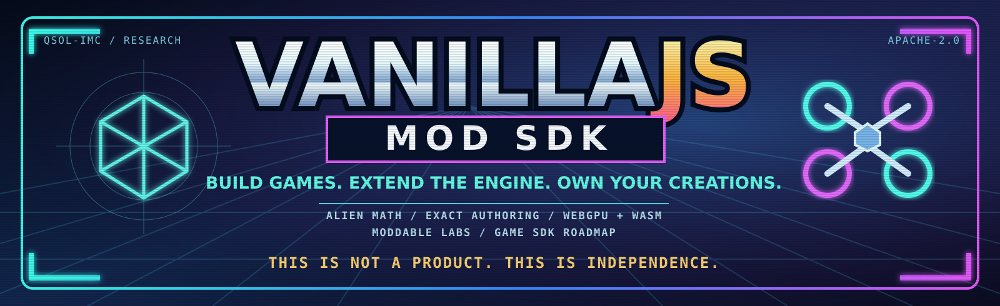

<p align="center">
  
</p>

<p align="center">
  <a href="https://doi.org/10.5281/zenodo.24049474"></a>
</p>

**You Didn't Invent Doom Edition — independently specified arithmetic, formally checked mathematics.**

**QSOL–IMC motto:** Make amazing alien tech and put it under an Apache 2.0 license. 🛸

**Next-generation editor (development):** [v1.5.0 — The Component Forge](docs/COMPONENT_FORGE.md) extends the visual workbench with strict schema-v2 components, real XYZ transform handles, snap-aware editing and component-driven Play mode. Existing v1 scene files migrate explicitly; the v1.4.0 benchmark release remains unchanged.

Reusable JavaScript game modules built directly on web standards. The latest
published release is **[v1.4.0 — The Proof of Speed](https://github.com/QSOLKCB/VANILLAJS/releases/tag/v1.4.0)**,
with source-bound CPU and physical RTX optimization evidence, complete-output
parity and fail-closed offline cache tests. Bullet Time and ARCADE labs arrived
in v1.3.0; the exact Q16.16 and formal-verification foundation remains intact.

The v1.0.0 showcase was The Clockwork Vault: six OMI seals in one expedition.
The engine has 32 experimental game modules and sixteen recipes including
Integer Foundry, alongside the registered OMI and optional E8 research labs.

[v1.4.0 Proof of Speed (in development)](docs/PROOF_OF_SPEED.md) · [Visual Editor (alpha)](demos/editor/index.html) · [Editor contracts](docs/EDITOR_WORKBENCH.md) · [Bullet Time Lab](demos/bullet-time-lab/index.html) · [ARCADE Lab](demos/arcade-lab/index.html) · [Offline build & OPT contracts](docs/DONOR_LABS_OFFLINE.md) · [Donor upgrade: pacing, lead solver & RTX](docs/DONOR_UPGRADE_2026_11.md) · [UFF orbital physics & NEXUS contracts](docs/BLOAT_NEXUS_UFF.md) · [Frame invalidation](docs/FRAME_GATE.md) · [Pooled A*](docs/NAVIGATION_POOL.md) · [Appearance composition](docs/APPEARANCE.md) · [Adaptive donor kernels](docs/ADAPTIVE_DONOR_EXTRACTION.md) · [Terrain & ballistics](docs/TERRAIN_BALLISTICS.md) · [Integer engine](docs/INTEGER_ENGINE.md) · [Build a game](BUILD_A_GAME.md) · [API contracts](docs/API.md) ·
[Architecture](docs/ARCHITECTURE.md) · [Verification](docs/VERIFICATION.md) ·
[Roadmap](ROADMAP.md) · [Module catalogue](MODULES.json) · [Geometry layer 2](docs/GEOMETRY_LAYER2.md)

## You Didn't Invent Doom Edition — exact Q16.16 and formal verification

**Modern convenience. Minimal dependencies. Old-school correctness.**

The integer simulation subsystem underwent an independent Q16.16 rewrite in
[PR #46](https://github.com/QSOLKCB/VANILLAJS/pull/46), followed by the
GALAXY-inspired numerical optimization in
[PR #47](https://github.com/QSOLKCB/VANILLAJS/pull/47).

- **Q16.16 simulation:** 65,536 subunits per metre; signed-int32 state,
  exact truncation toward zero, explicit overflow rejection and canonical zero.
  Existing RNG, engine snapshots and deterministic replay are preserved.
- **Optimized scalar mathematics:** safe-integer arithmetic fast path,
  corrected radix-65,536 quotient digits, and fast square-root estimates
  accepted only after exact integer-square bracketing.
- **Optional GLUBALL/QEC techniques:** exact u64 logical sampling,
  bounded partitions, and reversible GF(3) periodic lattice transforms
  validated against six pinned finite QEC fixtures. They are not changes
  to authoritative gameplay physics.

The design and limitations are documented in
[Q16-INDEPENDENT-001](docs/Q16_INDEPENDENT_REIMPLEMENTATION.md),
[Q16-GALAXY-RADIX-001](docs/Q16_GALAXY_RADIX.md), and
[GLUBALL/QEC numerical research](docs/GLUBALL_QEC_FIXEDPOINT_RESEARCH.md).
Preliminary numerical microbenchmarks are workload-specific, **not**
universal game-engine, GPU or frame-rate improvement claims.

### Q16-FORMAL-001 — Lean theorem and source-conformance evidence

Merged [PR #48](https://github.com/QSOLKCB/VANILLAJS/pull/48)
introduces **14 Lean 4.35.0 kernel-checked theorems** for quotient
certificates, exact radix-prefix invariants, signed bounds, precision
limits and integer square-root bracketing. The proof audit checks
every named declaration's transitive axioms, accepting only the
standard `propext` and `Quot.sound` where applicable. The successful
run reported no `sorryAx` or custom axioms.

The separate, finite BigInt oracle checked the exact production
`modules/integer-math/index.js` source (Git blob
`d457b0154d9dfc8b50fd593b5e9dff75e1ea66b9`):

| Executed verification | Observed result |
| --- | ---: |
| Lean mathematical theorems | 14 PASS |
| Accepted exact quotient cases | 220,921 PASS |
| Expected arithmetic rejection cases | 33,992 PASS |
| Integer square-root brackets | 200,009 PASS |
| Existing Q16 regression tests | 17 PASS |

[Successful Lean proof CI](https://github.com/QSOLKCB/VANILLAJS/actions/runs/42463350488)
· [Proof and claim boundaries](docs/Q16_FORMAL_001.md)
· [QSOL formalization context protocol](https://github.com/QSOLKCB/Private-Context-For-Formalization)

**Scope:** A Lean proof establishes named mathematical propositions.
Finite source-pinned testing supports the observed JavaScript implementation,
but does not prove full ECMAScript refinement, historical authorship,
copyright ownership, or the absence of copied material throughout history.
Existing provenance notices and Git history remain independently inspectable.

To reproduce after installing the toolchain pinned in `lean-toolchain`:

```sh
python3 scripts/verify-q16-proof-boundary.py
lake build Q16Formal
lake env lean Q16Audit.lean | tee q16-axiom-audit.txt
python3 scripts/verify-q16-axioms.py q16-axiom-audit.txt
node scripts/q16-formal-bridge.mjs
```

Lean is a development-time proof tool; the browser runtime remains dependency-free.

**Owner workstation (offline-first):** After a reviewed merge to `main`, open
[Q16-FORMAL-001 owner local Lean proof](.github/workflows/q16-formal-local.yml)
under **Actions → Run workflow**, choose `main`, and explicitly authorize
local execution. It targets the already-registered
`[self-hosted, linux, x64, qsol-rtx5060ti]` runner. This workflow requires a
**pre-installed or cached Lean 4.35.0** and an existing Node executable; it
does not fetch a toolchain or run any unreviewed PR code on your desktop.
Proof logs and a SHA-256 integrity manifest remain under
`~/.local/state/qsol/vanillajs/q16-formal/` by default. Artifact upload is
off unless the owner explicitly enables it. If Lean is unavailable, the
workflow fails with a prerequisite diagnosis rather than marking a theorem
as failed. The GitHub-hosted CI remains a separate validation surface.

## Qwen3-VL 2B text/image response isolation

The owner-only, no-API-credit
[QWEN2B-ISOLATE-001](experiments/freedm-open/QWEN2B-ISOLATE-001.md)
isolates the previously observed empty final output from the 2B
vision model. A pinned 14-case text-only versus original-game-image
matrix varies JSON schema mode and thinking settings, with local
Ollama version, model digest and complete source-bound JSON receipts.
It neither runs the FreeDM engine nor modifies the four-player live gate.

## FreeDM open-weight model comparison — experimental

The separate [FreeDM open-model FPS lab](experiments/freedm-open/README.md)
compares four small, locally hosted vision-language models against the **exact
48-screen Terra match evidence** (original Actions run 42374695320).
Qwen3-VL 2B/4B, Qwen2.5-VL 3B and Moondream 1.8B are executed through the
local-only Ollama API. A paired screenshot replay establishes behavioral
agreement and inference latency without randomized-spawn confounding.
A separately selected real four-client FreeDM pilot collects actual gameplay
but is explicitly marked exploratory because local model inference latency
and spawn conditions differ.

Both modes run **only after owner workflow dispatch on reviewed main**.
No paid API credentials, cloud inference, automatic model downloads or changes
to the previously preserved Terra/RTX evidence are involved.

## Experimental FreeDM × Four Terra deathmatch

The independent [FreeDM/Terra FPS research lab](experiments/freedm-terra/README.md)
introduces an **owner-dispatched, opt-in four-player Doom-engine deathmatch**
using the FreeDM WAD, four real local ViZDoom peers and four separate
GPT-6.1 Terra vision agents. It is *not* a browser runtime dependency,
packaged game, automatically running workflow or a validated completed match.
An offline four-player smoke must pass before any API call. The per-dispatch
authorization is US$5 per agent (US$20 total), with nonrefundable conservative
pre-request reservations and no automatic retries. Source-bound screenshots,
action vectors, actual game counters, token usage and SHA-256 manifests
are collected outside the checkout. No self-hosted hardware or credits are
used by ordinary PR checks. See the lab README for local WAD setup and
the explicit owner-only [workflow](.github/workflows/freedm-terra-deathmatch.yml).

## Run the labs

Download or clone the repository, then serve its root with any static HTTP server:

```sh
python3 -m http.server 8000
# Open http://localhost:8000
# Integer Foundry: http://localhost:8000/demos/integer-foundry/index.html
# Interaction Lab: http://localhost:8000/demos/interaction-lab/index.html
# FPS Lab: http://localhost:8000/demos/fps-lab/index.html
# RTS Lab: http://localhost:8000/demos/rts-lab/index.html
# OMI Lab: http://localhost:8000/demos/omi-lab/index.html
# Brass Engine: http://localhost:8000/demos/ancient-machine/index.html
# Clockwork Vault: http://localhost:8000/demos/clockwork-vault/index.html
```

There is no runtime installation, build step, npm dependency, CDN, account,
telemetry, external asset download or backend. All geometry is procedural.
The three 3D labs and The Clockwork Vault require WebGL 1; RTS Lab uses Canvas 2D. OMI Lab uses SVG and
Canvas 2D, retaining numerical controls if its atlas is unavailable. The Brass
Engine uses native SVG and DOM controls. A visible
message explains unsupported graphics. Serve over
HTTP(S): opening `file://index.html` is not supported by the ES-module entrypoint.
The local server works without internet access. Hosted offline reload via a
service worker is a future feature, not included in this milestone.

## 2D Foundry — gameplay movement, sound and ternary memory

New experimental <a href="demos/2d-lab/index.html">2D Foundry</a> combines
four integer-tick movement styles (RTS, shooter, platformer, top-down driving),
existing A* pathfinding and flow-field architecture, pure local PCM16 sound
effects, and a bounded 27-column ternary data store for UTF-8 `.txt` and
canonical `.json` documents. A reusable base-3 LUT and OPT-style invariant
snapshot reuse reduce redundant conversion without sacrificing independent
snapshot ownership.

**This is a 2D-first foundation, not a 3D engine or a persistent database.**
The 2D simulation has +Y up and explicit integer coordinates. The browser
converts them only for Canvas 2D; a future 3D adapter can map X/Y to a
documented world plane without rewriting source events. The ternary grid
is a lossless encoding, not compression, cryptography, storage hardware or QEC.
Save/restore explicitly downloads/uploads JSON; there is no automatic cloud
or disk persistence.

Strict sound effects are generated from sample-indexed integer PCM,
then optionally played through the browser's device pipeline; live playback
is **not** an identity-bearing renderer. All modes use independently tested
bounded input state. See [2D Foundation](docs/2D_FOUNDATION.md) for APIs,
replay claims, OPT evidence, and optional owner RTX / agent evaluation.
Hardware and OpenAI API services are never triggered by a push or pull request.

## November donor upgrade — clock pacing, lead solving and vault graphics

The pure-JS `FixedClock` optionally accepts `snapTolerance:.0005` (seconds)
to smooth browser-rounded presentation timestamps while **repaying every
accumulated clock adjustment**. The default is zero and preserves existing
timing behaviour. The `lead-solver` module computes bounded constant-velocity
intercepts, including configurable shooter-velocity inheritance. It returns
`null` for unreachable targets and does not implement gravity, target
acceleration, occlusion or gameplay auto-aim. Both features are independently
tested without changing existing games.

The Clockwork Vault now publishes its initial WebGL scene before signalling
graphics readiness. Its packaged browser test requires this first render and
samples a bounded number of actual animation frames, retaining the existing
visible-pixel threshold rather than accepting a blank canvas.

See the [source-pinned donor review, APIs and test limitations](docs/DONOR_UPGRADE_2026_11.md).
Physical RTX measurements require a separate **owner-dispatched, reviewed-main**
workflow after merge. Any evidence produced will be new; RTX001–004 remain
immutable, and CPU numerical timings are not GPU-compute or game FPS claims.

## BLOAT-OPS, NEXUS and UFF experimental research kernels

Four opt-in modules add a conservative Euclidean distance prefilter,
source-pinned complete integer replay validation, a bounded reversible
cuboctahedral Z4 lattice, and physically grounded **Newtonian orbital motion**
with explicit SI units and a velocity-Verlet integrator. The NEXUS model is
classical and its published Lean proofs do not automatically prove this new
JavaScript implementation. UFF's empirical extra-field galaxy model is
**not** represented as established physics. Existing simulation, collision
and rendering systems are unchanged.

Read the [source-pinned mathematical/physics contract](docs/BLOAT_NEXUS_UFF.md)
and use the new opt-in modules deliberately; no GPU or FPS improvement
is claimed from them until independently measured.

The owner-only [RTX 5060 Ti numerical and three-baseline validation](docs/BLOAT_NEXUS_UFF.md)
can be dispatched from reviewed `main` after this PR is merged. It verifies the
three historical source receipts while separately measuring new CPU numerical
kernels. It has no PR/push trigger; hardware use and artifact upload are
individually opt-in.

## QwakeTF-style reusable broadphase scratch

The existing `StaticAABBIndex` gains an opt-in `collectCandidates()` method,
which writes the same sorted candidate indices into a caller-reused array.
The original allocating `candidates()` remains the reference. Paired serial
measurements and exact candidate-set tests are documented alongside the
[pooled navigation experiment](docs/NAVIGATION_POOL.md).

## ARCADE-inspired idle frame reuse

An opt-in `FrameGate` uses explicit complete presentation keys to avoid
clearing or drawing unchanged images. Its synchronous transactional boundary
rejects failed renders and invalidates after resize, context change or an
explicit call. The original game loops and WebGL API are unchanged.
See [source-pinned contract and owner-only RTX comparison](docs/FRAME_GATE.md).

## Experimental pooled navigation

QwakeTF v0.2.0's exact-parity OPT work inspired a serial **pooled A***
workspace in `modules/navigation-pool`. It retains typed-array scores,
parents and a parallel heap across queries against the same immutable grid,
with generation stamps rather than full-array clearing. The original
`navigation.findPath` remains the authoritative reference and existing game
callers are unchanged. Full route and expansion parity is mandatory;
[see the source-pinned contract and workload](docs/NAVIGATION_POOL.md).

## Renderer-independent appearance composition

The opt-in `appearance` module adapts the **source-pinned colour-LUT,
deterministic actor variation, bounded hit-volume and high/low-detail emission**
architecture from QSOLKCB/CorpoWars3d PR #8. It compiles caller-defined
cuboid parts and emits them through one callback to either a software
renderer or the retained `CuboidStream`. No CorpoWars3d characters or artwork
are imported. [See the API and provenance contract](docs/APPEARANCE.md).

## Opt-in adaptive query and cuboid streaming kernels

The experimental `adaptive-circles` module compares a serial all-pairs
swept-circle reference with a bounded uniform-grid broad phase, switching
paths only above a configurable item count. The new `cuboid-stream`
module packs 12-float actor/geometry instances into retained CPU storage.
Both are informed by pinned GAMES and CorpoWars3d donor experiments and
retain independent parity and failure tests. Existing renderers and games
are unchanged. See [scope and source provenance](docs/ADAPTIVE_DONOR_EXTRACTION.md).

An optional [owner-run RTX 5060 Ti validation](docs/RTX5060TI_ADAPTIVE_VALIDATION.md)
will recheck the frozen RTX5060TI-001 evidence and run **new, separately
identified** adaptive/retained workloads after a reviewed merge to `main`.
The new hardware measurements have **not been executed** by this PR.

## Optional terrain and ballistic kernels

A small, pure-JS extraction from the owned Ski-Shooter and CorpoWars3d games
adds triangulated terrain sampling/sweeps and closed-form gravity stepping.
See [API boundaries and pinned donor provenance](docs/TERRAIN_BALLISTICS.md).
Neither kernel replaces the existing character solver, Integer Foundry or renderer.

## Integer engine — new development track

The new core runs authoritative game state on checked signed 32-bit fixed-point
values: **65,536 subunits per metre**, integer ticks and exact
16-bit-limb scalar arithmetic with an optimized radix-65,536 quotient path.
Exact raw
vector operations continue returning BigInt where required by the API. It provides atomic kinematic world updates,
static box collision, seeded integer randomness, canonical snapshots and bounded
input replay. Browser presentation converts positions to metres at the renderer.
No hardware oscillator, server, third-party engine or runtime package is needed.

**Integer Foundry** is the first complete recipe: climb four gantries, recover
power cells, then verify your recorded inputs against the full game state. A/D or
arrows move, Space jumps, Escape pauses; on-screen controls support touch.
The 120 Hz demo caps recording at 36,000 ticks. Serve locally as above, then open
`demos/integer-foundry/index.html`.

Existing flight/FPS controllers still use their original floating-point APIs.
This is an additive engine foundation, not a claim that all existing physics has
been converted. Static axis-ordered boxes are supported; dynamic rigid bodies,
rotations, slopes and moving platforms are outside the integer contract.
See [API, bounds and migration](docs/INTEGER_ENGINE.md).
The separate [integer-vector operators](docs/INTEGER_VECTORS.md) provide checked
3D fixed-point sums, widened dot/cross products, exact squared distances and
rational interpolation. They are experimental; existing gameplay paths are unchanged.

## Flight Lab

| Experiment | Flight model | Objective |
| --- | --- | --- |
| **The conduit** | Assisted 6DOF with velocity and angular stabilisation | Thread six signals through an industrial tunnel |
| **Open orbit** | Inertial 6DOF; momentum persists after releasing thrust | Visit six navigation beacons among static blocks and a docking structure |

Both use `createBody`, `stepFlight`, `FixedClock`, the same collision module and
the same renderer. Only world data and flight configuration change. The name
Open orbit describes the space setting: gravity and orbital mechanics are not
implemented. Signal acquisition uses a swept centre segment within each beacon's
acceptance sphere; rings are visual guides, not physical obstacles.

Tune thrust acceleration, angular acceleration, assistance and simulation speed
in the side panel. Hold **B** for quarter-speed bullet time; it scales simulation
time while keeping the interface responsive. Timing and physics use a fixed
120 Hz update with interpolated rendering. Long stalls have bounded catch-up.

| Action | Keyboard / pointer | Standard gamepad |
| --- | --- | --- |
| Forward / reverse, strafe | W / S, A / D | Left stick |
| Rise / descend | Space / Ctrl | RT / LT |
| Pitch / yaw | Mouse look (click view to capture), or arrow keys | Right stick |
| Roll | Q / E | LB / RB |
| Brake translation and rotation | Hold X | Hold A |
| Bullet time | Hold B; or use the time slider | Use the time slider |
| Pause / resume | Esc or the Pause button | Menu after launch |
| Restart | Reset | On-screen Reset |

Expand **Mouse, touch & gamepad controls** for on-screen flight buttons. Multiple
simultaneous pointers are supported. Launch, then click the view for captured mouse
look: moving turns the view directly; stopping stops the turn. Mouse takeover
levels roll, limits pitch just short of vertical and clears existing angular
momentum. Translation still follows the selected flight model. Arrows and Q/E
retain their original torque controls, including inertial angular coasting.
Escape releases the cursor and pauses; resume, then click to capture again.
Touch or denied/unavailable pointer lock uses relative drag-to-look with the same
no-spin behaviour. Keyboard controls still provide every flight axis.

Blur, hidden tabs and controller disconnect pause play. Resume is deliberate;
held inputs are cleared, and gamepads must return to neutral. Unmapped gamepads
are ignored rather than guessed. Experiments are session-only, with no saved
scores or progression. Menus support keyboard navigation and status announcements;
the 3D flight itself requires visual/spatial interaction.

## Interaction Lab

Open **Interaction Lab** from the Flight Lab header. Both new recipes share the
projectile system, conditional rule resolver and WebGL renderer:

| Recipe | Try this | What it demonstrates |
| --- | --- | --- |
| **Target practice** | Fire at a drone, open its shield field, then land four hits | Inertial 6DOF flight, swept shots, conditional damage and spent targets |
| **Reaction Bench** | Fire with ignition off; enable ignition; remove the O₂ feed; compare neon and an empty chamber | Successful, blocked and resisted outcomes with explicit reasons |

**Left click** while captured, **F**, or the on-screen **Fire** button shoots.
Clicking the view first captures mouse look without firing; arrows still turn. Target
practice retains WASD / Space / Ctrl / Q / E flight and X braking. Reaction Bench
uses a stationary observation point. **Line up a shot** repositions the camera,
clears projectiles and pauses; resume deliberately. Controls also support touch
and keyboard-activated buttons. These new recipes do not sample gamepads.

Pause, blur and hidden tabs freeze movement, projectile lifetimes and cooldowns.
Cancelled firing requires a fresh press. Slow motion scales the same simulation
clock. A bounded impact trail records the selected rule and missing conditions;
**Inspect the last outcome** exposes the structured result for debugging.

Chemistry examples are symbolic, source-backed rules with reusable specimens,
not quantitative chemistry simulation. See [model limits and sources](docs/INTERACTION_LAB.md).
No Reaction Rumble code, artwork or data is included.

## FPS Lab

Open **FPS Lab** from either lab header, then choose a proving ground:

| Recipe | Try this | Shared systems |
| --- | --- | --- |
| **Footwork** | Walk up four 25 cm steps, jump the amber hurdle, pass through the doorway and reach four markers | Upright character, static collision, eye pose and input |
| **Live range** | Clear three plates; compare instant traces and travelling bolts; empty and reload a magazine | The same character plus weapon timing, queries, projectiles and conditional effects |
| **Low passage** | Duck through two low roofs, stand in the open bay and reach the finish | Safe stance changes, headroom checks and crouched movement |
| **Tracking range** | Lead moving plates with travelling bolts; compare instant traces | Relative-motion queries, target interpolation and pause-safe tracks |
| **Clearance lift** | Ride up, duck under the beam and step onto the upper deck | Translating body collision, platform support and a safe clearance stop |
| **Shuttle run** | Ride across the gap, then walk or jump onto the far dock | Carry, jump-off momentum, landing and fall recovery |

Launch, then click the view for mouse look. **WASD** moves, **Space** jumps,
**Shift** sprints, hold **C** to crouch, **arrows** aim, captured **left click / F** fires, and **R**
reloads. Escape releases the cursor and pauses. On-screen controls and relative
look dragging remain available. A brief jump/fire/reload press survives until
its next physics tick. Pause clears controls and freezes ammunition timers;
resume requires fresh presses. The range's alignment buttons pause and reposition
the character while preserving ammunition and scores.

The default controller walks at 5 m/s, sprints at 8 m/s, and climbs steps up to
30 cm. Crouching lowers the 1.8 m body to 1.08 m and targets 2.5 m/s; releasing
C stands only when there is headroom. Feet stay in place and the eye follows the
stance. It is an upright **rectangular box**. Static courses retain automatic
stairs; the platform controller adds translating surfaces, riding and jump-off
momentum. On a blocked platform tick the demo stops the route while your controls
stay active: duck or move clear to continue. **Reverse route** pauses and changes
travel direction. Slopes, capsules and rotating platforms remain future work. See
[FPS contracts](docs/FPS_LAB.md).

## RTS Lab

| Recipe | Try this | Shared systems |
| --- | --- | --- |
| **Route planner** | Click open ground, run the route, then close the north gate | Grid snapshots, shortest paths, replanning and fixed ticks |
| **Squad orders** | Drag to select units, right-click a destination, watch them regroup | The same path search plus reachable unique destinations and cell reservations |
| **Flow convoy** | Deliver 24 couriers, move their depot, or close a gate | Incremental shared directions and safe field rebuilding |
| **Two-exit evacuation** | Evacuate 36 units; close the north exit to redirect the group | Multi-source nearest-exit fields and shared traffic reservations |

Plan while paused, then **Run routes**. Mouse drag selects; right-click moves.
Touch uses **Select / Move** tools and map taps. The roster and **Select all**
provide larger selection controls. With the map focused, arrows move the cursor,
Enter applies the tool, Space orders a move, and A selects all. Escape and lost
focus pause, cancelling unfinished gestures. Accepted orders persist on resume.

The lab uses four-neighbour cell movement and a bounded, game-owned traffic
policy. Units wait instead of swapping or overlapping; automatic retries may
still reach a stand-off. Reorder or stop selected units to resolve it. This is a
small routing slice; continuous steering and reciprocal body physics remain
future work. The flow recipes build one field over bounded fixed ticks, then
share it across every unit. Delivered units leave the map. Field rebuilding
freezes new cell moves until the new grid/destination map is complete.

See [RTS contracts and limits](docs/RTS_LAB.md) and the
[recorded search-work comparison](docs/FLOW_FIELDS.md). On the 64×64, 512-request
scenario, individual A* settles 809,826 cells; one shared field settles 3,655,
followed by 512 samples. These are search-operation counts, not measured FPS.

## Modules

| Import directory | Responsibility |
| --- | --- |
| `modules/navigation/` | Immutable grids, bounded A*, group destinations and incremental flow fields |
| `modules/math/` | Vectors, quaternions, camera matrices, seeded random numbers |
| `modules/time/` | Fixed ticks, interpolation fraction, pause, time scaling and catch-up limits |
| `modules/collision/` | Static/kinematic body sliding, finite static shots and translating-target segment queries |
| `modules/character/` | Upright movement, safe crouching, static stairs, platform riding and first-person view |
| `modules/weapons/` | Simulation-time fire cadence, magazines and finite-reserve reloading |
| `modules/flight/` | Force/torque integration; assisted and inertial control |
| `modules/input/` | Pure action state, keyboard/mouse adapters and standard gamepad sampling |
| `modules/render-webgl/` | Minimal WebGL 1 triangle, line and point rendering |
| `modules/projectiles/` | Bounded constant-velocity projectiles, swept impacts and lifetimes |
| `modules/interactions/` | Ordered conditions → effects with explicit outcome reasons |

API maturity remains **experimental**, including in 1.0.0. Use a tagged release or exact commit,
preserve the directory structure and record what your game imports. The
machine-readable catalogue lists each module's dependency closure and environment.
Core modules neither own an animation loop nor read the DOM or ambient time.

## OMI Lab — research experiment

**Credit: Brian Thorne's ARCH OMI.** [ARCH-OMI-001](docs/ARCH_OMI.md) implements
the pinned sixteen-bit rotate/XOR delta law and an explicit VANILLAJS encoding
of four nibble-valued tetrahedral vertices. Inspect the four faces, flip an
observed edge bit, apply reversible masks and survey all 65,536 words.

The exhaustive result distinguishes **return after eight steps** from **minimal
period eight**: 8 words have period 1, 56 period 2, 4,032 period 4 and 61,440 period 8.
An independent arithmetic oracle agrees on every output. Six derived edge
differences have only 4,096 patterns, each shared by sixteen words; closure does
not establish absolute identity or detect every coordinated change.

This lives under `experiments/arch-omi/`, separate from the game modules. Source
pins, encoding choices, API boundaries, controls and the executed evidence are
documented together. It adds no runtime dependency and makes no pathfinding,
physics, cryptographic, compression, RNG or speedup claim.

## The Brass Engine — a mechanical OMI demonstration

[Turn the crank](demos/ancient-machine/index.html) of an imagined ancient
calculating instrument: four hexadecimal drums, an eight-detent cam, visible
rotation/XOR lanes and a bounded receipt tape. Seven detents prepare the result;
the eighth latches one exact OMI delta step. Reverse individual detents, advance
a whole revolution or run the 120 Hz integer-tick motor.

Save and restore a local JSON replay at any partial position. Pause, Escape and
focus loss freeze the motor; continued input requires a fresh press. Reduced
motion, keyboard operation and narrow touch layouts are supported. This is a
fictional mechanical presentation of discrete logic, not a historical replica or
physical analog solver. [Mechanism and replay contract](docs/BRASS_ENGINE.md)
include exhaustive evidence and attribution to **Brian Thorne’s ARCH OMI**.
It remains demo-owned; no new core API or game recipe is added.

## The Clockwork Vault — v1.0.0 showcase

[Enter the vault](demos/clockwork-vault/index.html): walk through one original
chamber, operate six OMI consoles, raise gates and a causeway, ride a counterweight
lift, and reach the keeper’s exit. WASD/mouse, arrow look and on-screen touch
controls compose existing modules without a new engine or runtime dependency.

Each console reuses the Brass Engine’s eight-detent calculation and adds XOR
levers. Independently verified shortest solutions increase from two to seven
commands. Bounded hints guide the next step; undo cancels a pending revolution
or reverses a command. Released seals stay released. Local JSON saves preserve
player pose, moving mechanisms, command histories and partial motor ticks.

**1.0.0 names the completed showcase milestone.** It does not silently promote
experimental module contracts or OMI research to stable APIs. [The game contract
and evidence](docs/CLOCKWORK_VAULT.md) document input cancellation, save validation,
approximation limits and attribution to **Brian Thorne’s ARCH OMI**.

## Explicit GPU API (experimental)

The optional [`/api/webgl` device](api/README.md) offers retained XYZ/RGB
buffers, exact Float32 change detection, partial vertex updates, explicit
frame submission, cached GL state and fail-closed recovery. It uses the
existing browser WebGL1 standard with no new runtime dependency or scene graph.
It does **not** replace the normal renderer or retroactively claim an RTX
performance improvement. Hardware measurements remain separately pinned.

## Development and verification

Node.js 22+ is development tooling only. There is no `npm install` for these checks:

```sh
node --test tests/*.test.js
node scripts/check.js
node scripts/build.js
node scripts/navigation-workload.js --check
node scripts/verify-omi.js --check
node scripts/verify-machine.js --check
node scripts/verify-vault.js --check
node scripts/opt-render-workload.js --check
# Optional formal verification (requires pinned Lean in lean-toolchain)
lake build Q16Formal
lake env lean Q16Audit.lean | tee q16-axiom-audit.txt
python3 scripts/verify-q16-axioms.py q16-axiom-audit.txt
node scripts/q16-formal-bridge.mjs
```

The build stages an allowlisted `dist/` and generates `manifest.json` with sizes
and SHA-256 hashes. The manifest identifies packaged bytes; it is not a signature.
`npm test`, `npm run check`, and `npm run build` are optional aliases.

CI also installs pinned Playwright outside the checkout and exercises the
packaged `/VANILLAJS/` path in Chromium with software WebGL. Its screenshots and
manifest are retained as the `flight-lab-evidence` artifact. See the verification
document for executed checks and remaining coverage limits.

## GitHub Pages

Set **Settings → Pages → Source → GitHub Actions**. Pull requests verify the
package without deploying. Pushes to `main` deploy the same artifact only after
simulation, contract and Chromium checks pass. The workflow separates read-only
validation from Pages deployment permissions. No tag or release is created by CI.

## Authorship and attribution clarification — COMMENT-001

**Maintainer statement (Trent Slade, QSOL-IMC): I did not steal or copy
the work of the X account referenced in COMMENT-001 into VANILLAJS.**
I dispute the copying/attribution allegation shown in the preserved screenshot.

VANILLAJS is developed within QSOL-IMC. Its original implementations, external
references and specifically adapted donor techniques are distinguished in
[NOTICE](NOTICE), the [technical provenance documents](docs/ARCHITECTURE.md)
and Git's source history. Where another QSOL repository informs a technique,
the source commit and licence are documented; that is not a claim of authorship
over the donor's work.

The screenshot documents an **allegation**, not proof of plagiarism; it does
not identify a matching file, commit, code excerpt or asset. See the dated
[COMMENT-001 evidence and full citation](evidence/COMMENT-001/README.md),
including Slade (2026), *COMMENT-001: YouTube comment incident and AI-mediated
attribution claims — an image dataset*, v1.1.0,
[DOI:10.5281/zenodo.24026140](https://doi.org/10.5281/zenodo.24026140).
This attribution statement is the maintainer's position; it is not represented
as an independent adjudication. Specific checkable source comparisons remain welcome.

## Scope and licence

This is a compact foundation, not a general rigid-body contact solver. Colliders
use fixed-orientation cubes or rectangular bodies. Body movement uses static
axis-aligned boxes or translating kinematic surfaces; shot queries also track
translating boxes. There are no reciprocal dynamic body contacts, oriented-box contacts, friction, bounce, atmospheric
flight, orbital gravity, audio engine, map editor or network synchronisation yet.
Numerical tolerances and runtime limits are documented in [API.md](docs/API.md).

The repository's existing [Apache-2.0 licence](LICENSE) is preserved. See
[NOTICE](NOTICE) for authorship and reference provenance. No ripped assets or
third-party game engine source are included.

## Owner-activated RTX 5060 Ti full-path validation

The optional [trusted local NVIDIA validation workflow](docs/RTX5060TI_TRUSTED_VALIDATION.md)
compares the exact pre-geometry-optimization SHA against reviewed `main` on a
physical RTX 5060 Ti, recording CPU geometry, collision, statistical allocations,
submitted GPU uploads, native pixel parity and observed frame timings.
It runs only on explicit owner activation, never in a normal push or PR build;
ordinary hosted CI performs syntax preflight and verifies the immutable-content
receipt, not a physical GPU rerun. The successful owner-run validation is now
preserved as [VANILLAJS RTX5060TI-001](evidence/RTX5060TI-001/README.md),
tied to commit `240617e8bc1a935f05eaf75a10531f194f72a173`.
The recorded gains are workload-specific and do not establish an FPS increase or
cryptographic hardware attestation.
The owner independently rechecked the frozen archive on Ubuntu on 2026-11-07;
see the [offline local verification record](evidence/RTX5060TI-001/LOCAL-VERIFICATION.md)
(PASS, matching SHA-256; not a rerun of GPU measurement).

The separately dispatched adaptive-kernel and retained-rendering benchmark is
preserved as [RTX5060TI-002](evidence/RTX5060TI-002/README.md), pinned to
`b39b0bd0db5ba9b467b9e47aede4edc4dd156e9f`. Its original Actions ZIP
is byte-identical to the uploaded artifact and verified in hosted CI.
The new serial-circle and retained/fresh WebGL workloads have **no historical
RTX5060TI-001 equivalent**, and the observed results are not universal FPS claims.

The subsequent [RTX5060TI-003 and COMMENT-001 documentary record](evidence/COMMENT-001/README.md) includes the exact original and derived screenshots, independently pinned by SHA-256 and Git blob IDs. The screenshot records a disputed public allegation and the maintainer's response; it does not independently prove that copying occurred.

The successful ARCADE frame-invalidation comparison is recorded as
[RTX5060TI-003](evidence/RTX5060TI-003/README.md), tied to
`3f5518a168652a003e8db9aa6dc0371ddb4782ea`. Both original RTX001 and
RTX002 source candidates were rerun under the same current hardware protocol.
The new FrameGate workload achieved nine matching pixel checkpoints per pair
and omitted 39 of 48 draws; the measured completion-time benefit was modest
(10.4 ms vs 10.0 ms). This is **not a native-game FPS improvement claim**.
