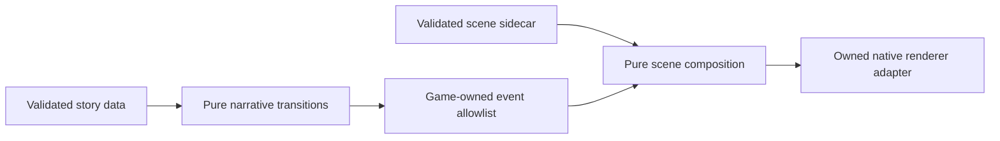

# SCENE-NARRATIVE-001 — Scene & Narrative Foundry

**Proposed release:** v2.7.0. **Published baseline:** v2.6.0 — The Game Feel &
Sprite Foundry. **Reviewed base:** `7f2d5e62bb64aaf8c6ef7af8df678da9fe38412d`.
The owner merged PR #101 and published v2.6.0 before authorising this milestone.
This implementation remains a candidate for separate owner review and release.

## Public additions

| Addition | Reusable responsibility | Working consumer |
| --- | --- | --- |
| [scene-graph](../modules/scene-graph/index.js) | Validated hierarchy, affine local/world conversion, typed descriptors, transform animation, nested prefabs | [Workbench Scene Composition](../demos/editor/index.html) |
| [narrative](../modules/narrative/index.js) | Inert story graphs, typed conditions/effects, objectives, diagnostics, deterministic choices and saved progress | [Narrative Foundry](../demos/narrative-foundry/index.html) |

Both are experimental, opt-in APIs. `scene-graph` depends only on `math`;
`narrative` is dependency-free. Pure modules own neither the DOM nor devices,
ambient clocks, GPU resources, audio contexts or game-specific fiction.

## Creator workflows

**Compose a scene:** use the Workbench's Scene Composition panel to build on
existing scene authoring, inspect parent/child transforms, compose reusable
prefabs, sample animation, preview and export the validated sidecar. Camera,
light and appearance descriptors travel with scene data; applications own their
rendering interpretation. [The composition guide](SCENE_COMPOSITION.md) specifies
controls, transforms, bounds, supported components and resource disposal.

**Tell a story:** open Narrative Foundry, create a node, write dialogue, link a
choice, edit its condition and effects, and preview the consequences. The original
short story demonstrates distinct outcomes and a visible scene change. Export
and reimport reusable story data and progress. Inspect graph diagnostics and
repair a rejected edit without losing accepted content.
[The creator tutorial](NARRATIVE_FOUNDRY.md) explains the actual steps and exports;
[the API reference](NARRATIVE_API.md) describes a separately owned game integration.



The event boundary is an application mapping of known event IDs. A story cannot
request an import, run JavaScript/HTML, call a renderer or instruct a coding agent.

Both workflows are reachable through the Creator Hub, README and validated agent
catalogue. A creator can keep the JSON files and use their public-module contracts
in an independent project. Neither download claims to be an arbitrary complete game.

## Compatibility and numerical contracts

- Existing Workbench v1/v2 scene/project imports, original game exporter and Mod
  SDK formats retain their schemas. The scene-composition sidecar is separate;
  migration is never implicit. Existing physics bodies remain roots.
- Hierarchical composition uses Float64 affine transforms and documented
  right-handed +Y-up/−Z-forward conventions. Nonuniform parent scale can create
  shear; conversions must not silently discard it. Singular/invalid data is
  rejected within the documented bounds. This is not a new physics solver.
- Capturing a legacy scene preserves its local transform data. Rotated children
  under nonuniform parent scale can look different in the full-affine preview
  from the legacy decomposed approximation; the original scene is unchanged.
- Keyframed animation samples caller-supplied time. Presentation does not advance
  authoritative simulation. Nested prefab expansion has explicit capacity/depth
  and cycle limits; resources belong to the adapter and must be disposed.
- Narrative traversal is discrete and deterministic for the same validated
  story and choice history. Conditions operate on declared typed variables;
  effects use a bounded vocabulary. Cycles require another explicit choice and
  are bounded; there is no hidden automatic traversal loop.
- Saves are bound to exact canonical story content and replay-validated choice
  history. They are local progress data, not an anti-cheat/security authority.
- Invalid/unsupported/oversized imports must finish validation before accepted
  authoring or preview state is replaced. Render handles and executable callbacks
  are not serializable story or scene content.
- No existing public module signature/default is changed. The historical
  package/catalogue `1.0.0` fields stay intact. Q16.16/ALIEN MATH proofs, archived
  evidence and exact integer contracts are not extended by scene rendering.

## Source, ownership and packaging

New code, fiction, scene examples and presentation are original first-party work
under Apache-2.0, using existing native engine facilities. Branching narrative
and small scene components are authoring principles; no complete external engine
or story editor is ported. No runtime package, remote asset, CDN, cloud service,
account or telemetry is introduced. Preserve LICENSE/NOTICE with consuming code.

Workbench and Narrative Foundry use content-derived native-module namespaces.
The existing package verifier rebuilds the known generated namespaces from source
and checks byte identity. Runtime files remain allowlisted and budgeted. Source-bound
browser reuse, qualification, trusted-main authority and manual full-browser
execution remain unchanged. No personal hardware runner is invoked.

Required verification:

```sh
node --test tests/*.test.js
node scripts/check.js
node scripts/build.js
node scripts/verify-offline.js
node scripts/browser-check.js
git diff --check
```

The new authoring/browser scenarios belong to the `editor` suite. Local browser
execution uses already provisioned external Playwright/Chromium, not a shipped
runtime dependency. The [execution record](evidence/scene-narrative-001/README.md)
records the tested source, package identities, actual outcomes, corrections and
inspected screenshots. Unsupported browsers/devices and inferred behaviour are separate
from actual execution; no unmeasured performance improvement is claimed.

## Games2 compatibility

Games2 is unchanged. A later, separately reviewed game PR must select an immutable
owner-reviewed engine release, retain source provenance and test its own integration.
The owner decides when another game starts; this programme grants no source-copying
or cross-repository modification authority.

| Future consumer | Implemented candidate seam | Game-owned or still proposed |
| --- | --- | --- |
| Tactical FPS | Narrative mission dialogue/objectives/events; existing weapon-feel/combat3d | Mission rules, dialogue content and event adapters |
| RPG / adventure | Branching choices, typed variables, save/restore; hierarchical scene data | Campaign fiction, inventories and complete game loop |
| Space exploration | Narrative missions and scene composition; existing flight/audio | Ship systems, exploration rules and encounters |
| Futuristic investigation | Conditional clues, objective transitions and branching outcomes | Evidence mechanics, authored cases and UI |
| RTS campaigns | Briefings/objectives/events; scene and navigation primitives | Unit AI, campaign simulation and missions |
| Survival | Declarative quest/objective state and saved progress | Crafting, world streaming and survival simulation |
| Intros / cinematics | Scene transforms/tracks plus existing Demoscene Foundry | Game-owned sequence orchestration and transitions |
| Arcade / platformers | Existing sprite2d, motion2d/combat2d; scene/narrative data where useful | Tilemaps and Game Maker facade in v2.8 |
| Racing | Existing track/road primitives, scene descriptors and story events | HORIZON rendering/dynamics/authoring in v2.9 |

[Draft v2.7.0 notes](SCENE_NARRATIVE_2_7_0_DRAFT.md) ·
[Remaining programme and gates](ENGINE_EXPANSION_001.md) ·
[Games2 integration policy](GAMES2_INTEGRATION.md)
