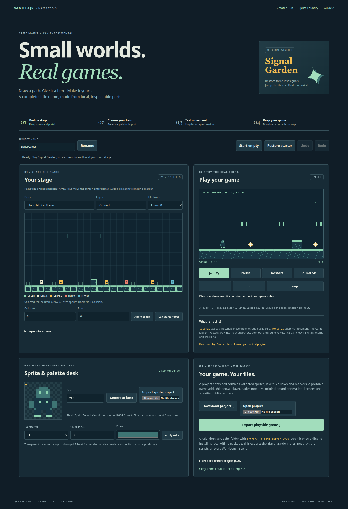

# GAME-MAKER-001 — execution record

Tested implementation source: **`f02e0b70ad9f3b47d4c4261618da8be3e838a506`**. Reviewed base:
`70e63b902834ae31b994ea40ae584bd93892e6bf`, published as v2.7.0 after PR #102.
Runtime and harness bytes were frozen before the final required checks and full
browser run. Live cache pins were finalized and separately tested during that
run without changing the package or harness. The implementation commit contains
this directory's placeholder; the subsequent evidence-only commit replaces it
and adds these records. This is local execution evidence, not a release or
reusable trusted-main CI receipt.

[Machine-readable record](execution.json) binds changed source files to SHA-256
and Git blob identities. [Package manifest](package-manifest.json) lists every
shipped file. Source/package preservation is checked independently of screenshots.

## Executed gates

| Command | Actual result | Record |
| --- | --- | --- |
| `node --test tests/*.test.js` | 1,060 passed; zero failed/skipped | [TAP](node.tap) |
| `node scripts/check.js` | 459 JS files, 67 module contracts, two experiments; provenance checks; 601 local links, 126 imports, 11 workflows | [Log](source-check.log) |
| `node scripts/build.js` | 887 packaged files | [Log](build.log) |
| `node scripts/verify-offline.js` | 887 files, 5,908,667 bytes verified | [Record](offline.json) |
| `node scripts/browser-check.js` | All seven groups passed: home, render, play, worlds, research, donor, editor | [Full log](browser.log) |
| Cache/profile/provenance/receipt regressions | Passed after final live profile update | [TAP](cache-tests.tap) |
| `git diff --check` | Passed | Recorded in execution JSON |
| All seven source closure analyses | Zero unresolved issues, explicitly local/untrusted | [Analysis](cache-closures.json) |

Worker SHA-256: `02ebcaf1fc191541b18ec4d098fab437db44e74b7fc9c88c46aa5822582f0894`.
Node v22.18.0, Python 3.14.4, Linux x64, existing external Playwright 1.64.0
and Chromium 158.0.8127.18 with headless SwiftShader. No browser install or
owner-only hardware dispatch occurred. Hosted CI provisions its pinned browser
separately. No group in the full local run was skipped or satisfied by a witness.

[Focused API browser](api-focused.log) and [focused Lab browser](lab-focused.log)
also passed against the final package. The complete Node run includes 34 new
API, tilemap, Lab and export tests plus the existing regression suite. An
additional independent exploratory tile-sweep probe compared 654 admitted moves
across 20 generated maps against a one-subunit X/Y reference; this is review
support, not a replacement for the checked-in reference tests.

## Actual new browser coverage

- Native Canvas primitive/text/sprite pixels, atlas/parallax alignment, invalid
  import and allocation rollback, supplied fixed ticks/input cancellation,
  seeded bounded particles, independent instances, native Web Audio ownership
  and failure cleanup.
- The public-only Ember Relay example is actually played through movement,
  jumping to an elevated pickup, reaching the exit, restarting and disposal.
- Original Signal Garden win/lose, restarting, and building a playable game from
  an empty stage through floor/spawn/collect/exit brushes. Sprite seed, source
  pixels, hero/tileset palette, visual layers, collision and parallax edits are
  accepted through the real controls.
- Strict malformed/unsupported import rollback, literal HTML-like names,
  bounded history, keyboard editing, real touch emulation, brief jump taps,
  held-input cancellation, actual sound voice and blur cleanup, narrow 320 px
  layout and unavailable-Canvas authoring/export fallback.
- The actual browser download is parsed as ZIP; every manifest entry is hashed.
  It is served independently under a nested prefix, played, installed and
  navigated offline through its correct scoped worker. An intentionally damaged
  runtime refuses installation. Cached Lab export also works with networking off.
- Canvas loss/restoration and persisted-navigation regression events are
  **explicitly dispatched**. They verify cleanup/reconstruction and accepted
  project retention; they do not claim native Canvas context-loss or physical
  device coverage. The ending/catch-up regression checks one event emission.
- Failed module imports leave visible reload recovery. A **synthetic hostile
  older-worker fixture** retains poisoned unversioned modules while the new Lab
  starts through its content-derived namespace. This is isolation evidence,
  not a claim that a historical release contained those poisoned bytes.
- Every existing lab, rendering/input, Workbench, Creator Gateway, Demoscene,
  scene/narrative and research group also completed in the full run.

## Failed attempts and corrections

These earlier attempts are not final PASS records.

1. The first combined export/unit run had two failures because the generated
   portable source archive was older than concurrent player changes. The source
   freshness guard correctly rejected it. The archive was regenerated after
   source freeze; no guard was relaxed.
   [Earlier TAP](export-stale-archive-failure.tap).
2. The initial full Node run passed 1,058 tests and failed one catalogue check
   while its linked creator guide was still being written. The completed guide
   is included and the final full run passes.
   [Earlier TAP](node-first-failure.tap).
3. A later documentation audit caught source/example paths under the catalogue's
   runnable-lab-only `examples` field. They were moved to `entryPoints`, with
   the actual Lab index retained as `examples`. An intermediate empty-examples
   attempt was also rejected by the existing schema. The validator was unchanged.
   [First audit failure](catalogue-first-failure.log).
4. The first API browser test compared an entire Canvas frame after redraw and
   found 47 differing antialiased green edge pixels from native circle drawing.
   The transactional asset test now compares the exact nearest-neighbor sprite
   rectangle; primitive center, text, atlas and parallax assertions remain.
   [Failure](api-first-failure.log), [pixel diagnostic](api-pixel-diagnostic.log).
5. Review corrected source-data size handling to keep maximum admitted art
   projects reimportable, applied symlink/size/UTF-8 checks to the worker template,
   and checked shell/CSS resource closure. Export tests cover these boundaries.
6. Input review corrected press/release taps between rendered frames and pending
   touch/keyboard cancellation. Lifecycle review corrected finished-run reset,
   stale audio-resume completion, repeated ending events during catch-up, stale
   export completion and reconstruction after cached navigation. Browser cases
   exercise these corrections; accepted authoring state remains transactional.

The final frozen runtime's required checks and complete seven-group browser run
passed. No existing assertion, numerical contract, proof or historical evidence
was removed to obtain those results.

## Preservation and limits

All pre-existing module/API files, formal proofs, research files, execution
records and workflows match the reviewed base byte for byte. The record also
checks AGENTS, licensing/notices, package metadata, historical README/roadmap
archives, Games2 integration policy, frozen browser policy, receipt authority
and worker template. All existing catalogue module/recipe/experiment records are
unchanged; additions are additive. The ALIEN MATH changes extend its live capsule
build-tool allowlist and synthetic fixture only, preserving archived evidence.

The live browser profile adds the Lab and its exact sources, harnesses and
runtime namespaces. One authenticated reviewed-main execution, source/package
checks, manual full execution and fail-closed behavior remain required. The
local analysis here grants no reuse authority.

Tile collision uses bounded integer whole-body sweeps, X then Y. It is not a
slope, rotated-body, moving-platform or general dynamic collision solver.
Structural validation cannot prove an authored level is reachable or balanced.
The game export supports the example's declared original rules; it is not a
compiler for arbitrary scripts or a Workbench project conversion. Existing
formats/defaults remain. Sprite asset licensing declarations travel with exports.

Integer gameplay identity is separate from cosmetic Float64 particles, Canvas
text/rasterization and encoded images. No physical GPU/RTX, phone, controller,
Firefox/Safari or unmeasured performance claim is made. Games2 was not modified.
HORIZON v2.9 remains future work gated through three separately reviewed PRs.

## Inspected visuals

Actual final packaged Chromium screenshots, not concept renders:

[Game Maker Lab at 320 px](game-maker-mobile.png)

[Milestone and Games2 compatibility](../../GAME_MAKER_001.md) ·
[Creator tutorial](../../GAME_MAKER_LAB.md) ·
[Public API](../../GAME_MAKER_API.md) ·
[Tilemap contract](../../TILEMAP_API.md) ·
[Portable export](../../GAME_MAKER_EXPORT.md) ·
[Draft v2.8.0 notes](../../GAME_MAKER_2_8_0_DRAFT.md)
