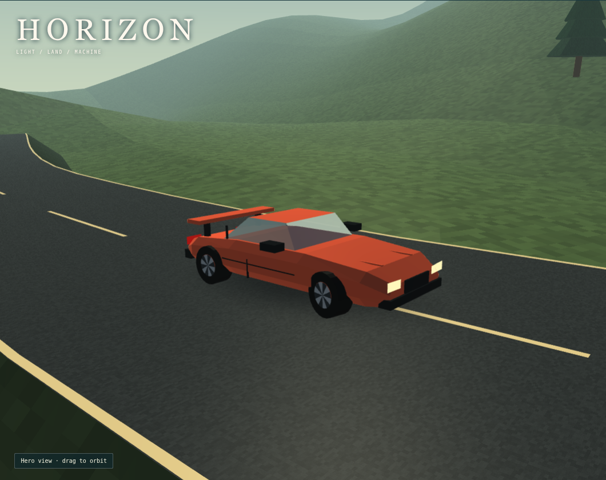
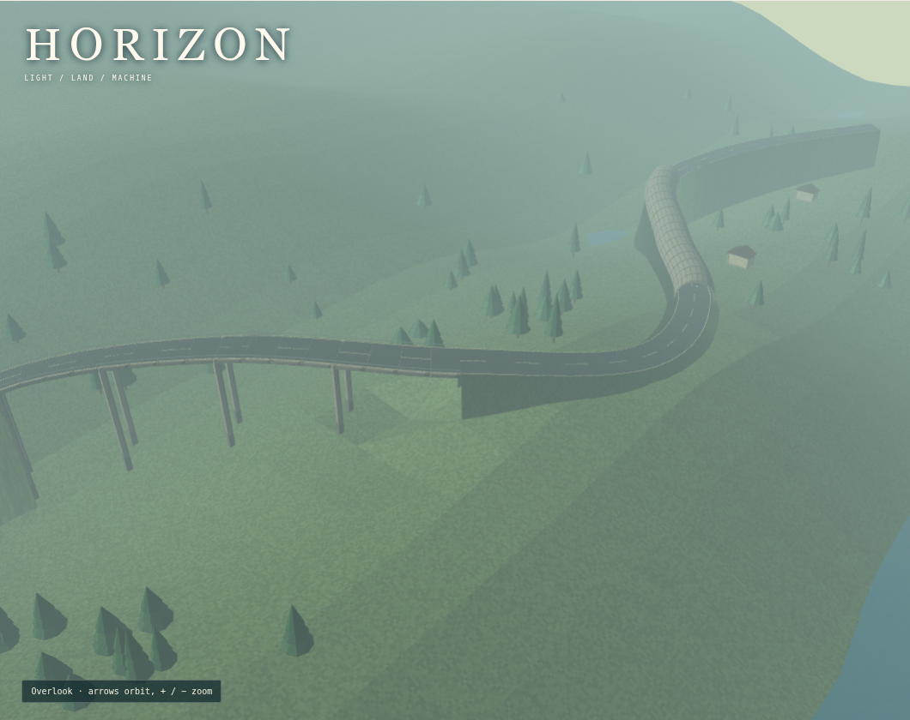

# HORIZON-001 execution evidence

Tested implementation: **`3b80e491238bba104187e969ecd1844d2b6d9d6a`**.
Published v2.8.0 baseline: `f7cd8d6a61791128b12fd72f8c94b6481889d197`.
The following evidence-only commit adds this record without changing the tested
runtime or harnesses. This is the first of three required HORIZON PRs.

## Actual execution

| Check | Result | Evidence |
| --- | --- | --- |
| `node --test tests/*.test.js` | 1,079 passed; zero failures/skips | [TAP, gzip](node.tap.gz) |
| `node scripts/check.js` | 470 JS files, 69 modules, two research experiments; 645 links and 12 workflows passed | [Log](source-check.log) |
| `node scripts/build.js` | 911 manifest entries | [Build](build.log), [manifest](package-manifest.json) |
| `node scripts/verify-offline.js` | All 911 entries verified, 6,177,338 bytes | [Result](offline.json) |
| Chromium home/render/play/research | Complete groups passed | [Log](browser-home-render-play-research.log) |
| Chromium editor | Complete group passed, including HORIZON and existing creator tools | [Log](browser-editor.log) |
| Chromium worlds | Complete group passed | [Log](browser-worlds.log) |
| Chromium donor | Complete group passed | [Log](browser-donor.log) |
| Existing Racing Lab smoke | Seven modes, Track Foundry, Canvas/WebGL, lifecycle and layout passed | [Log](racing.log) |
| Cache/provenance/receipt tests | 27 passed | [TAP](cache-tests.tap) |
| Python evidence-capsule tests | 16 passed | [Log](capsule-tests.log) |
| Seven browser source closures | Zero issues; explicitly local/untrusted | [Issues](source-profile-issues.json), [full profiles, gzip](source-profiles.json.gz) |
| Existing source/evidence preservation | 239 baseline files retain identical Git blobs | [Comparison](preservation.json) |
| `git diff --check` | Passed before implementation and final evidence commits | Recorded in execution JSON |

The existing `--suites=` selector collectively executed all seven groups. An
earlier combined command ended with signal 15 (exit 143) after Demoscene, without
a failed assertion in its output. The reason was not established. Its
[interrupted log](browser-combined-interrupted.log) is preserved; partial results
are not substituted for the complete group results. No assertion or timeout was
relaxed.

```sh
node --test tests/*.test.js
node scripts/check.js
node scripts/build.js
node scripts/verify-offline.js
node scripts/browser-check.js --suites=home,render,play,research
node scripts/browser-check.js --suites=editor
node scripts/browser-check.js --suites=worlds
node scripts/browser-check.js --suites=donor
node --test tests/browser-cache-profile.test.js tests/browser-package-provenance.test.js tests/browser-receipt-codec.test.js
python3 -m unittest discover -s tests -p test_alien_math_bundle.py -v
git diff --check
```

Environment: Linux x64, Node **22.18.0**, existing external Playwright **1.64.0**,
Chromium **158.0.8127.18**, headless SwiftShader. Browser commands used
`NODE_PATH=/home/trent/.local/share/qsol/browser-tools/node_modules` and
`PLAYWRIGHT_CHROMIUM_EXECUTABLE=/home/trent/.cache/ms-playwright/chromium_headless_shell-1254/chrome-headless-shell-linux64/chrome-headless-shell`.

The unchanged Racing harness does not accept that executable environment option.
Its [first attempt](racing-default-browser-failure.log) requested absent revision
1248. A [local launcher](racing-browser-selection.mjs) selected the same installed
revision 1254 used above, then ran unchanged assertions with
`node --import /tmp/horizon-racing-browser.mjs scripts/racing-smoke.mjs`.
No browser was downloaded/reinstalled. No owner-only runner, physical GPU,
controller or mobile device was used. Other browser engines remain unverified.

## What the new tests establish

- Nine pure scenery cases cover exact road mesh/contact triangles, independent
  plane-height references, stacked surfaces, identical low/high road and terrain
  contacts, normals, seeded arrays, budgets, formats, vehicle geometry/rig and
  admitted extreme recipes.
- Six renderer cases cover material/matrix admission, ownership, exact no-op
  reuse, failed allocation, budgets, disposal and lost handles. Native Chromium
  adds actual light/roughness/pattern/glass/fog/shadow pixels, zero GL errors and
  context-loss/recreation.
- Four Lab data cases cover roundtrip, strict inert rejection, geometry admission
  and visual-pose bounds. Packaged interactions exercise real controls, three
  classes, height/bank edits, material/light/rig pixels, history, rejected imports,
  stale file reads, downloads, minimum-length steep roads, idle rendering, native
  restoration, 320px touch layout and graphics fallback.
- Offline authoring and export ran with networking disabled on a fresh page
  controlled by the installed worker. Separate startup checks exercise a retained
  older worker and failed-import recovery at `/VANILLAJS/`.

Numerical array/contact identity does not imply cross-device shader identity or
physical driving fidelity. Existing integer maths, formal evidence, Racing Lab
and Track Foundry v1 are unchanged. Games2 was not modified.

## Inspected visuals and measured resource counts

Actual captures show an original lofted car, circular wheels, glass, finish,
road elevation/bank, embankments, bridge, tunnel, terrain and coast. The
[unchanged Racing Lab coastal sprint](existing-racing-sprint.png) is a visual
reference, not a matched-scene performance benchmark.





[Full desktop](horizon-desktop.png) · [Tunnel approach](horizon-road.png) ·
[320px touch-emulated layout](horizon-mobile.png).

| Original scene | High | Low |
| --- | ---: | ---: |
| Retained vertices including car/shadow | 46,374 | 32,148 |
| Retained mesh bytes | 2,040,456 | 1,414,512 |
| Meshes / mesh draws per frame | 25 / 25 | 25 / 25 |
| Initial mesh uploads | 25 | 25 |
| Road contact triangles | 192 | 192 |
| Terrain cells | 3,136 | 3,136 |

There is one additional sky draw. Camera/light changes retain the initial 25
uploads; material/visual-rig reuse is also asserted. Still frames schedule no
continuous render loop. [Raw counts](budgets.json) are diagnostics, not an FPS
benchmark or physical hardware-performance claim.

## Failed attempts and corrections

- Early source/Node audits ran while linked guides were still being written:
  [source attempt](initial-missing-guide.log), [Node attempt](initial-node.tap.gz).
  Final source checks and all 1,079 tests pass with both real guides complete.
- A native recovery run exposed deletion of already-lost GL objects after
  restoration: [failure](renderer-context-disposal-failure.log). Disposal now
  skips native deletion for lost resources; final native recovery passes. An
  earlier setup requested restoration in the same turn as loss and stalled;
  bounded native-event waits corrected that setup before the real bug was found.
  Some default-sandbox Node attempts reported only file-level TAP; only complete
  case-level executions are claimed above.
- Initial [scenery](scenery-fixture-correction.tap) and
  [Lab](lab-fixture-correction.tap) tests had fixture mistakes: an unchanged
  coordinate used as a negative case, and mutation of frozen admitted data.
  Fixtures were corrected; rejection assertions remain intact.
- Review found an assumed terrain-height ceiling, visual rotation limits
  narrower than admitted steep roads, and a shadow station outside very short
  roads. Actual geometry bounds, bounded ±π visual angles and a shared clamped
  car station fix these cases; regression coverage verifies them.
- The combined-browser interruption and absent default Racing executable are
  recorded above. Complete grouped execution and the selected installed browser
  pass without changing repository assertions.

## Package and trust boundaries

[Execution JSON](execution.json) records exact source and artifact identities.
Manifest SHA-256:
`a9e7d6a5b6c267edf9c8646e9ceb5fda57a222d0ee83f115757483b31cfe55fd`.
Worker SHA-256:
`469d4d6ab216cb7b2d7f7cd08c9420c7070622c3b7c3c49b5ba6727ea7e059ee`.
The complete seven-group run used the [earlier package manifest, gzip](full-suite-package-manifest.json.gz).
A late ten-byte guide correction clarifies road-edge coordinate bounds; only
`docs/SCENIC3D_API.md` and its generated worker identity differ. Every executable
asset is byte-identical: [exact comparison](package-guide-correction.json). The
editor group and offline verifier were rerun on the final package above; the
other groups and Racing smoke were not repeated for this text-only change.
[Earlier verifier](full-suite-offline.json), [earlier source closures](full-suite-source-profiles.json.gz)
and [earlier editor execution](browser-editor-before-guide-correction.log) remain
recorded. This evidence append is excluded from the runtime; a final rebuild
compares its complete manifest byte-for-byte with the final tested package.

Live cache changes bind the new sources, harnesses and generated namespaces.
Qualification remains **one authenticated reviewed-main execution**. Frozen
policy, receipt authority, workflows and owner-runner restrictions are unchanged.
These local logs are not a reusable trusted-main receipt. No merge, tag, release,
deployment, package-version migration or Games2 change occurred.
