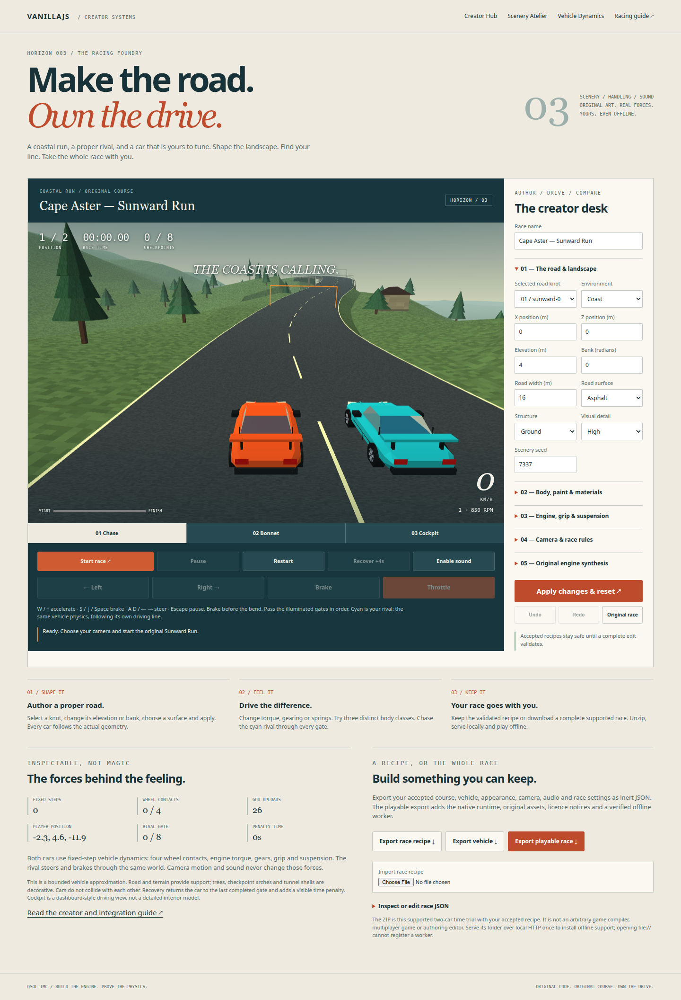

# HORIZON primary-entry correction

The reported published `/VANILLAJS/demos/horizon-lab/index.html` served the original
**Coastline Atelier**, with **Start camera tour** and no race controls. This was a
navigation/entry mismatch: the scenery demonstration deliberately rotates its
camera, while the physical racing game was at `race.html` in the open PR.

Candidate: `f064917ca3a104f9502a6bdced9e813f48e64693`, following PR head
`f26cfa3fcf04010170b65a97e3b2e17fbf3ae3f1`. A subsequent evidence-only commit adds
this directory; it is not included in the public build. Prior HORIZON evidence
is preserved unchanged.

| URL within `demos/horizon-lab/` | Behaviour |
| --- | --- |
| `index.html` | Canonical playable Race Foundry: Start race, W/up throttle, steering, rival and checkpoints |
| `race.html` | Compatible entry to the identical race page |
| `scenery.html` | Preserved visual authoring and camera-tour workshop |
| `drive.html` | Preserved vehicle-dynamics study |

Primary navigation and current creator/API/agent references follow this mapping.
The package and source-bound browser authority explicitly verify all four HTML
rewrites against one immutable native-module closure. No engine or lab runtime
JavaScript changed; qualification remains one trusted main run and frozen policy
is unchanged. There is no PR deployment. The published URL changes only after
owner merge and the main Pages workflow.

## Executed on this candidate

- `node --test tests/*.test.js`: **1,170 passed**, no failures/skips; [TAP](node-tests.tap.gz).
- `node scripts/check.js`: passed; 503 JS files, 71 modules, two experiments,
  760 links, 153 imported sources and 12 agent workflows; [log](check.log).
- `node scripts/build.js`: passed, 969 manifest entries; [log](build.log).
- `node scripts/verify-offline.js`: passed, 6,997,660 bytes; [record](offline.json).
- `git diff --check`: passed.
- All seven source-bound input closures resolve with no issues;
  [local profiles](source-profiles.json), not trusted CI execution receipts.
- Packaged Chromium: canonical index, race alias, real keyboard car movement and
  full eight-checkpoint completion; visible Scenery Atelier navigation and return;
  all three workshop/player flows, narrow touch controls, graphics/audio failures,
  offline startup, failed-import recovery and older-worker isolation passed.
  [Browser log](browser.log), [exact launcher](browser-launcher.txt).

The six browser functions executed are `checkHorizonRace`, `checkHorizonRaceStartup`,
`checkHorizon`, `checkHorizonStartup`, `checkHorizonDrive` and
`checkHorizonDriveStartup`. They use the actual packaged runtime under `/VANILLAJS/`.
Other browser groups retain their separately recorded initial milestone execution;
this follow-up does not claim they were rerun locally. GitHub CI is separate.
Existing Playwright 1.64.0 / Chromium 158.0.8127.18 with SwiftShader were used;
no browser installation or physical GPU/mobile/controller validation occurred.

[Source/package identities](identities.json) and [actual race diagnostics](horizon-race-diagnostics.json)
identify this execution. The browser confirms that W changes the car's world
position; it does not confuse camera orbit with vehicle motion.

## Earlier attempt

An initial packaging-fixture edit accidentally changed the Arcade and Block Arena
fixture startup markers along with HORIZON. Both existing assertions correctly
failed. Their original fixtures were restored; only the HORIZON fixture was
changed, and the focused packaging tests and full suite then passed. The
[initial output](initial-fixture-attempt.tap.gz) and [corrected run](packaging-fixed.log)
are retained. No runtime assertion or historical evidence was weakened.
