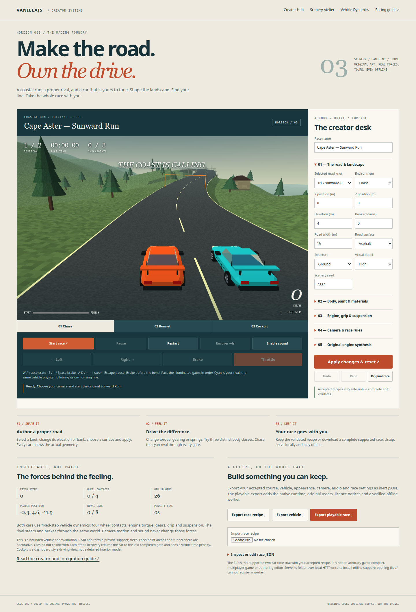
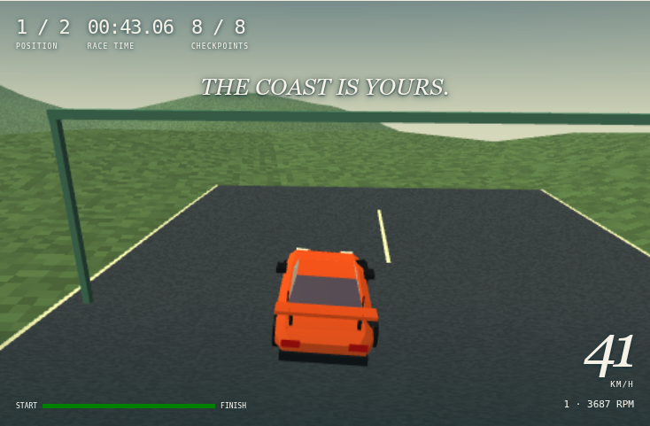

# HORIZON-003 execution record

Executed locally on 17 November 2026 Australia/Adelaide (16 November UTC).
Runtime candidate: **`dc5e4d72916685ed4379c2dd4976ae87e2bc86dd`**.
Reviewed base: **`718afebb7146424ed8718f80a488c3b76eea1c85`**, merged PR #107.
The follow-up evidence commit changes only this directory, which the public
builder does not ship. It does not change the tested runtime or package hashes.

These are fresh local executions, not reused or authenticated-main CI receipts.
GitHub CI on the PR is a separate execution. The live one-main-run qualification,
source binding, manual full-browser override and frozen proof policy are unchanged.

## Executed checks

| Command / coverage | Actual outcome |
| --- | --- |
| `node --test tests/*.test.js` | 1,170 tests passed, 0 failures/skips; [complete TAP, lossless gzip](node-tests.tap.gz) |
| `node scripts/check.js` | 503 JavaScript files, 71 module contracts, 2 research experiments; source/provenance checks and 740 documentation links/12 agent workflows passed; [log](check.log) |
| `node scripts/build.js` | Passed after regenerating/reviewing the exact portable runtime; 968 manifest entries |
| `node scripts/verify-offline.js` | All 968 entries and worker verified; [result](offline.json) |
| `git diff --check BASE...HEAD` and working diff | Passed |
| CLI `export-horizon-race.mjs PROJECT.json --out NEW_DIRECTORY` | A complete new 31-file race directory; [result](cli-export.json), [identities](portable-identities.json) |
| Chromium `home,render,play` | Passed; [log](browser-home-render-play.log) |
| Chromium `worlds` | Passed; [log](browser-worlds.log) |
| Chromium `research` | Passed; [log](browser-research.log) |
| Chromium `donor` | Passed; [log](browser-donor.log) |
| Chromium `editor` | All 19 unchanged function selections executed in two bounded partitions: 3 new and 16 existing checks; [new](browser-new.log), [existing](browser-editor.log) |
| Source-bound browser input closure | All seven profiles have zero unresolved issues; [local fingerprint record](source-profile.json) |
| Protected source comparison | All 294 pre-existing engine/proof/evidence/CI/licence/legacy-track files compared are unchanged; [record](preserved-source.json) |

The normal browser command remains `node scripts/browser-check.js --suites=editor`.
For local execution limits, the editor group was partitioned by its actual runner
inventory without skipping assertions or replacing test functions. The exact
[executed launcher](editor-partition-executed.txt) and a [portable reproduction](editor-partition.mjs)
are retained. From the repository root, with existing Playwright available through
`NODE_PATH` and `PLAYWRIGHT_CHROMIUM_EXECUTABLE`, run the reproduction with `new`
and `legacy`. The portable transcription parameterizes machine paths and was syntax
checked; the logs record the original launcher executions. Hosted CI retains the
normal full group.

Other groups ran through the normal repository command with
`--suites=home,render,play`, `--suites=worlds`, `--suites=research` and `--suites=donor`.
No browser tooling was installed or reinstalled. Node/browser child processes ran
in the permitted execution environment after sandbox-only attempts could not
reliably spawn children.

## Source and package identity

[identities.json](identities.json) records each new/consumed module identity,
the source SHA and complete package identity. [manifest.json.gz](manifest.json.gz)
preserves the exact complete manifest bytes.

- Package: 968 manifest entries, **6,983,091 bytes** excluding the manifest itself.
- Manifest SHA-256: `57a8df45954962253876174f87ea919d16bd24680d14dce005c050ce9c88aa3c`.
- Worker SHA-256: `d923d58d1282e7cb3a9b1384b9927b6b97b4b397995fdfed4de918e62b0b3968`.
- The standalone CLI package uses the original high-profile project. The actual
  browser-downloaded ZIP test selects low detail; these are intentionally different
  project/package identities, both built from the same checked source.

The standalone browser check extracts the actual UI download, verifies exact
manifest coverage/digests and notices, serves it at `/creator/exports/sunward/`,
finishes the route through real keyboard handlers, then loads and drives it offline.
The worker controls only that exported scope. A fresh install with altered
`project.json` never acquires offline authority. The exported data module is
validated/escaped; project data never selects scripts, source paths or URLs.

## Actual browser observations

[Environment](environment.json): Node 22.18.0, Playwright 1.64.0, Chromium
158.0.8127.18, Linux x64, native WebGL1 with ANGLE SwiftShader requested.
No physical RTX, phone, controller, Safari or Firefox validation was performed.

[Recorded diagnostics](horizon-race-diagnostics.json):

| Observation | Measured value |
| --- | --- |
| High profile | 43,260 vertices; 1,903,440 uploaded bytes; 26 meshes/uploads; 62 mesh draws per frame |
| Low profile | 30,660 vertices; 1,349,040 uploaded bytes; 26 meshes/uploads; 62 mesh draws per frame |
| Keyboard route completion | 43.0667 simulated race seconds; 8/8 gates; win; no recovery |
| Rival at player finish | Approximately 425.96 m travelled along the route through actual vehicle physics |
| Full-route render observation | 2,884 frames with retained 26 uploads; 34,774 ms test wall time |

The full-route driver reads only copied diagnostics, selects real key transitions
and advances the browser's test clock. It does not teleport, mutate checkpoints,
call the simulation step directly or bypass the input layer. The wall time includes
browser automation/software rendering and another concurrent browser group; it is
**not a measured real-time FPS or hardware-performance claim**. Pixel output remains
separate from numerical identity. Independent numerical tests cover fixed-step
cadence, actual gate crossings, opposite direction/re-crossing, skipped gates,
bank support, real rival completion and recovery penalties reversing the winner.

The browser checks also exercise meaningful route/vehicle/audio edits, all three
cameras and car classes, retained uploads/idle stop, history/rejected imports,
export invalidation/retry, held-input cancellation, native touch cancellation,
optional audio/device failure and overlapping resume requests, native graphics
loss/restoration, fallback editing, and prefixed offline play. Synthetic older-cache
fixtures and failed module imports exercise startup recovery; these are explicitly
hostile test fixtures, not a claim about bytes in an old published release.

These actual screenshots were inspected for layout, original car/scenery
presentation, checkpoint readability, HUD and narrow-screen controls:

[320 px viewport screenshot](horizon-race-mobile.png) uses browser touch emulation,
not a physical-device claim. Cockpit is a dashboard-style driving viewpoint, not
a complete vehicle interior. Cars are non-contact pace opponents; decorative
buildings/tunnels are not chassis colliders. Arbitrary edited courses still require
play-testing, and manual-gearbox recipes require consuming controls or the specialist
driving study. See the [creator contract](../../HORIZON_003.md).

## Earlier attempts and corrections

- Initial audio regression setup failed on an unfilled expected PCM fixture;
  its observed Node 22 source hash was recorded, alongside independent input,
  continuity, bounds, seed and lifecycle tests. It is a regression fixture, not
  a proof of physical acoustics or cross-engine PCM identity.
- An early race negative fixture tried mutating already-frozen accepted scenery;
  it was corrected to clone its input before testing rejection.
- Export tests correctly rejected a stale generated archive while its source
  was still being edited. The final archive was regenerated after source freeze
  and independently checked against every included source byte.
- A hostile-name test originally placed Unicode separators at the end of a name,
  which correctly violated the trimmed-name contract. Moving them inside the name
  exercised safe generated-literal escaping without weakening validation.
- Independent review found stale audio completions could stop a newer request,
  arches could ignore bank/grade, and a centreline-height diagnostic could falsely
  reject a car supported on a banked road. Corrections have focused regressions.
  Additional tests prove recovery penalties change results and passed gates cannot
  be counted again by reversing/re-crossing.
- Default sandbox child-process attempts produced execution restrictions, including
  `spawnSync git EPERM` during identity capture. Actual test suites were executed
  with permitted child processes; identity capture was repeated successfully.

All seven browser groups and all final Node/package checks passed. Historical evidence,
assertions and frozen policy were not changed to obtain a pass.
