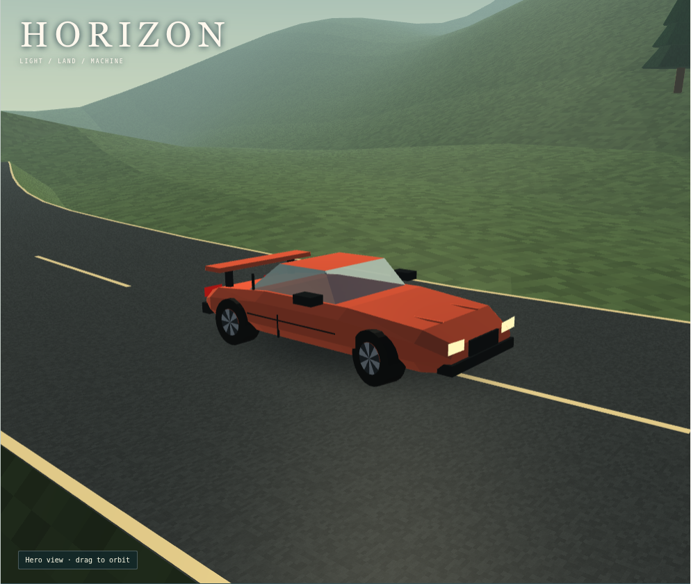
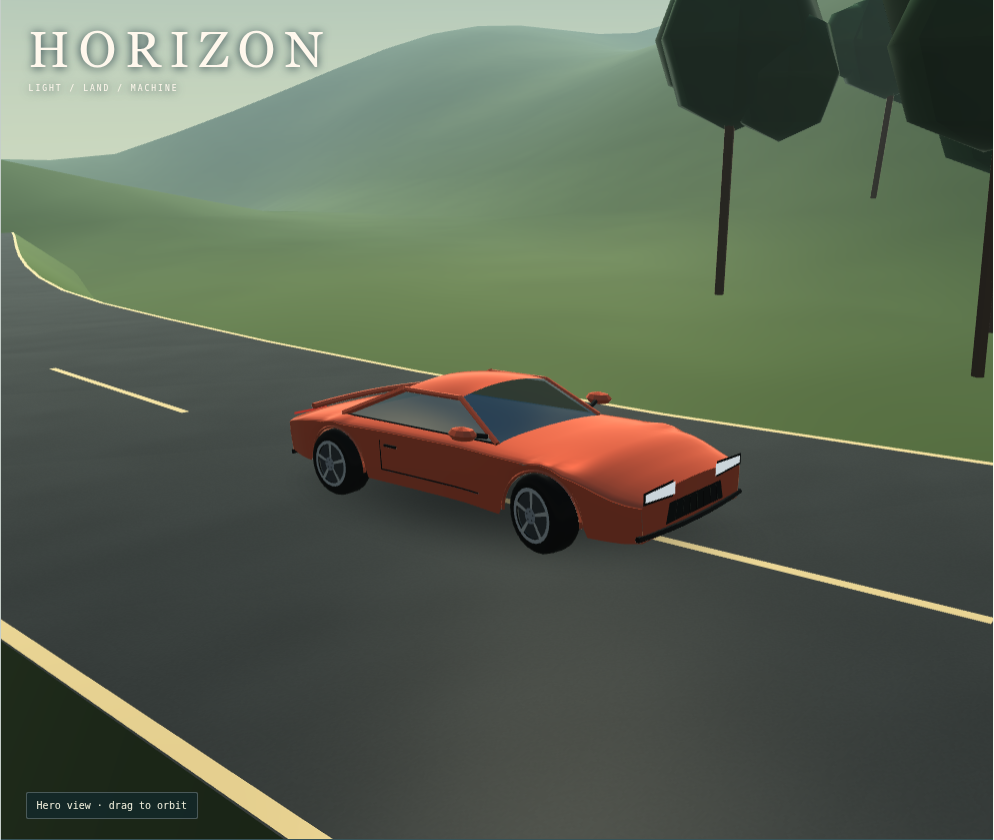
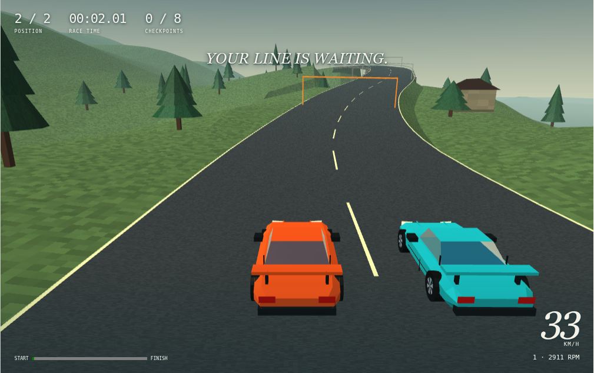
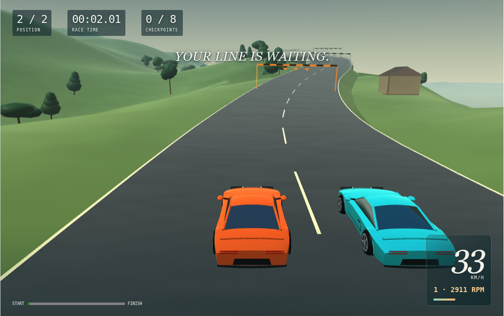

# HORIZON-004 execution and visual evidence

Audited base: `f263d43627970d8c3cfb2d54eed8fdeed2e7c457`.
Clean implementation source: `3bb5c5925dd7741cf307fc0b41134900875035e3`.
Later evidence/documentation commits do not change this implementation.
The existing external tooling is Node 22.18.0, Playwright 1.64.0 and Chromium
158.0.8127.18 on Linux x64, using SwiftShader. No physical GPU, phone or controller
execution is claimed. These local records are not authenticated main CI witnesses.

## Matched visual comparison

The untouched baseline and candidate use the same authored project/seed, camera
position/quaternion/FOV, 1440×1100 viewport and device scale 1. Profile resolution
is also equal. At-speed views use actual W input, real vehicle steps and a pause
around five simulated seconds (three countdown plus two driving), not a state
setter. Exact state/ticks are in each capture record; fixed camera matching does
not claim that browser event scheduling is identical. The candidate's new chase
composition is also exercised by the unforced gameplay screenshots.

| Sport hero before | Sport hero after |
| --- | --- |
|  |  |

| Racing before | Racing after |
| --- | --- |
|  |  |

All twelve pairs were inspected: rounded bodywork, open arches/alloys and cleaner
glazing are plainly visible; terrain checker/facet artifacts are reduced; the
road/tunnel, vegetation and checkpoint presentation improve. Low keeps the same
road contacts with fewer decorations/pixels. Stylistic limits remain documented.

Timing is wall-clock draw submission plus synchronous one-pixel readback, after
two warmups, twelve samples per view. Values are **milliseconds**, not FPS. Short
SwiftShader samples are environment-specific observations, not hardware promises.
The extra shading/detail costs more than the baseline. The first geometry pass
was trimmed after measurement; equivalent scalar/vector noise reuse is separately
verified. No CI timeout or test gate was relaxed.

| View/profile | Before | After | Median ms before → after | After p95 ms |
| --- | --- | --- | --- | --- |
| scenery-hero-high | [before](before/scenery-hero-high.png) | [after](after/scenery-hero-high.png) | 28.5 → 54.8 | 57.3 |
| scenery-orbit-high | [before](before/scenery-orbit-high.png) | [after](after/scenery-orbit-high.png) | 27.1 → 44.6 | 48.1 |
| scenery-road-high | [before](before/scenery-road-high.png) | [after](after/scenery-road-high.png) | 24.2 → 43.3 | 47.4 |
| scenery-bonnet-high | [before](before/scenery-bonnet-high.png) | [after](after/scenery-bonnet-high.png) | 31.7 → 59.9 | 65.7 |
| scenery-hero-low | [before](before/scenery-hero-low.png) | [after](after/scenery-hero-low.png) | 12.1 → 27.8 | 30.1 |
| scenery-orbit-low | [before](before/scenery-orbit-low.png) | [after](after/scenery-orbit-low.png) | 13.8 → 23.4 | 26.4 |
| scenery-road-low | [before](before/scenery-road-low.png) | [after](after/scenery-road-low.png) | 11.8 → 23.4 | 24.7 |
| scenery-bonnet-low | [before](before/scenery-bonnet-low.png) | [after](after/scenery-bonnet-low.png) | 17.6 → 29.7 | 31.4 |
| race-chase-high | [before](before/race-chase-high.png) | [after](after/race-chase-high.png) | 27.4 → 53.5 | 59.6 |
| race-speed-high | [before](before/race-speed-high.png) | [after](after/race-speed-high.png) | 22.8 → 51.7 | 54.8 |
| race-chase-low | [before](before/race-chase-low.png) | [after](after/race-chase-low.png) | 15.2 → 25.6 | 31.1 |
| race-speed-low | [before](before/race-speed-low.png) | [after](after/race-speed-low.png) | 16.3 → 28.7 | 33.0 |

## Retained resource measurements

Counts include all uploaded meshes, including offscreen geometry. GPU mesh bytes
are vertices × 44; CPU copies also occupy storage. The fullscreen sky is one
additional draw and buffer outside the reported mesh count.

| Default view/profile | Vertices before → after | GPU mesh bytes before → after | Mesh draws before → after | Initial candidate uploads |
| --- | --- | --- | --- | --- |
| scenery-hero-low | 32,148 → 59,052 | 1,414,512 → 2,598,288 | 25 → 25 | 25 |
| scenery-hero-high | 46,374 → 105,600 | 2,040,456 → 4,646,400 | 25 → 25 | 25 |
| race-chase-low | 30,660 → 57,237 | 1,349,040 → 2,518,428 | 62 → 46 | 33 |
| race-chase-high | 43,260 → 96,897 | 1,903,440 → 4,263,468 | 62 → 46 | 33 |

The race shares the same 13 uploaded car parts between player and rival. Camera,
physics and light changes retain uploads. Eight retained gate batches reduce
structural gate draws from 24 to 8; independent tests preserve their original
world-space structure. New area-weighted visual normals never replace contact
normals. Independent baseline hashes pin every original road and terrain triangle.
Maximum 32-knot recipes remain within existing 100,000/280,000 world budgets.

## Source and package identities

- [Before capture](before/capture.json): manifest SHA-256 `53a8285e6cd93447657ff54198214e976255cd5f66a313e1ddee1620670fc411`; [complete inventory](before/manifest.json).
- [After capture](after/capture.json): manifest SHA-256 `a477027506a7be159bf22347f19c6d34ded9837ce8e7b54fa913d298a8ce2780`; [complete inventory](after/manifest.json).
- Each capture records native renderer data, exact camera, simulation snapshot,
  draw/upload/buffer counts, timing samples and SHA-256 of its original PNG.
- [Shader reuse experiment](shader-reuse/README.md) preserves the executed source
  snapshots, diagnostics and full native-pixel parity observations. Deliberately
  wrong noise-corner evaluation is rejected by the persistent browser test.
- [Published main check](published-main-check.json) independently confirms the
  prior deployment fix: the public URL starts the race and real W input moves
  the vehicle. Main run 43965787695 completed verify and deploy successfully.
  This was read-only verification; HORIZON-004 has not been deployed.

## Executed verification

- `node --test tests/*.test.js`: **1,208 passed**, zero failed/skipped.
  [Complete TAP](checks/h004-node-all.log).
- `node scripts/check.js`: **506 JS files, 71 module contracts, two research
  experiments**, provenance checks and documentation audit passed.
  [Log](checks/h004-check.log).
- `node scripts/build.js`: **971 files**; `node scripts/verify-offline.js`:
  **7,112,372 bytes verified** at the implementation source.
  [Build](checks/h004-build.log), [offline](checks/h004-offline.log).
- ALIEN-MATH-006 Python **5/5**, selected Node source/cache/security tests **41/41**,
  exact historical workflow blob/SHA-256 and source-pin check passed.
  [Python](checks/h004-security-alien-python.log),
  [Node](checks/h004-security-node.tap),
  [source pins](checks/h004-security-source-pins.log).
- All 24 workflows match reviewed main, including the 35-minute timeout,
  main-only Pages gates, permissions and action pins. 807 historical `evidence/`
  files and 229 historical `docs/evidence/` files are unchanged.
  [Preservation audit](checks/h004-security-preservation.log).
- `git diff --check` passed. Lean proof sources/gates remain unchanged; a new
  physical/GPU or local Lean theorem run is not claimed by this milestone.

`node scripts/browser-check.js --suites=render,editor` passed all **25**
packaged suite functions under `/VANILLAJS/`. [Complete browser log](checks/h004-browser-final.log).
Coverage includes the eight-gate race, actual forward/reverse input, rival,
collision/recovery, all three cameras, recipe round trips, portable ZIP, offline
reload, WebGL context recovery, older-worker isolation, 320px touch controls,
shader pixels, the existing Workbench/Asset Foundry, creator tutorial, scene/
narrative, sprite and Game Maker workflows.

The keyboard race completed eight checkpoints in **43.0667 simulated seconds**,
with zero recoveries; the rival advanced **425.959 m**. Mesh uploads stayed at
**33** across 2,884 rendered race frames. Keyboard reverse moved the player’s
Z position from **−11.9401 to −9.4721 m** using actual gear −1; wheel spin and
audio gear also followed it. Touch reverse steered and moved backwards while
checkpoint index remained zero. Tests also verify safe forward return, explicit
braking, focus cancellation and independent offline reverse.

[Race and reverse telemetry](gameplay/horizon-race-diagnostics.json) ·
[Driving diagnostics](gameplay/horizon-drive-diagnostics.json) ·
[Scenery budgets](gameplay/horizon-budgets.json) ·
[Unforced chase at speed](gameplay/horizon-race-at-speed.png) ·
[Race finish](gameplay/horizon-race-finish.png) ·
[320px reverse](gameplay/horizon-reverse.png).

| Packaged browser function | Seconds |
| --- | --- |
| render/checkRenderLit | 1.12 |
| editor/checkHorizonRace | 84.20 |
| editor/checkHorizonExport | 54.31 |
| editor/checkHorizonRaceStartup | 0.89 |
| editor/checkHorizonDrive | 22.70 |
| editor/checkHorizonDriveStartup | 0.75 |
| editor/checkHorizon | 10.18 |
| editor/checkHorizonStartup | 0.86 |
| editor/checkGameMakerAPI | 2.37 |
| editor/checkGameMaker | 13.91 |
| editor/checkGameMakerStartup | 0.32 |
| editor/checkNarrativeFoundry | 3.26 |
| editor/checkNarrativeStartup | 0.28 |
| editor/checkSceneComposition | 2.90 |
| editor/checkTutorial | 1.32 |
| editor/checkSpriteFoundry | 3.28 |
| editor/checkSpriteStartup | 0.27 |
| render/verifyIntegerFoundry | 1.53 |
| render/verifyRenderReuse | 6.49 |
| render/verifyWebGLAPI | 0.15 |
| render/verifyFrameGate | 0.09 |
| render/verifyVault | 52.68 |
| editor/verifyEditor | 7.33 |
| editor/verifyEditor4X | 3.27 |
| editor/checkCreator | 0.78 |

## Final documentation package

After browser execution, the guide gained its evidence link. Rebuilding changed
only `docs/HORIZON_004.md` and the content-derived worker identity; every runtime
and harness byte remains the tested implementation. The final package was built,
offline-verified and documentation-audited again. All seven browser source
profiles resolve without issues. [Final comparison](final-package.json),
[manifest](final-manifest.json), [offline check](checks/h004-final-offline.log),
[documentation audit](checks/h004-final-docs.log). Hosted CI must verify the actual
PR head; this record does not claim an authenticated main execution.

## Failed attempts and corrections

The first capture attempt used an ambiguous camera selector; it now selects the
actual button. Timing originally measured command submission; the accepted
records use synchronous readback. First-pass images exposed bonnet ridges and
flat terrain facets; bounded Hermite interpolation/fender-only arch lift and
shared visual normals corrected them. Excess hidden endcaps/tessellation were
reduced after cost inspection. A real maximum low scene exposed temporary
allocation overflow in all three views; independent failure tests reproduced it,
then verified transactional renderer renewal and rollback. No failed attempt is
reported as a PASS and no previous evidence was replaced.

The owner still must review, merge, verify the deployed-main race and explicitly
approve v2.9.0. This PR does not tag, release or deploy.
