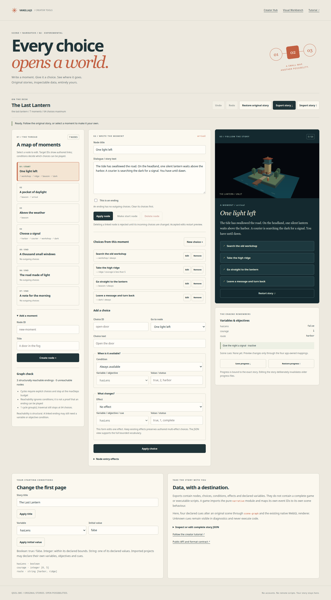
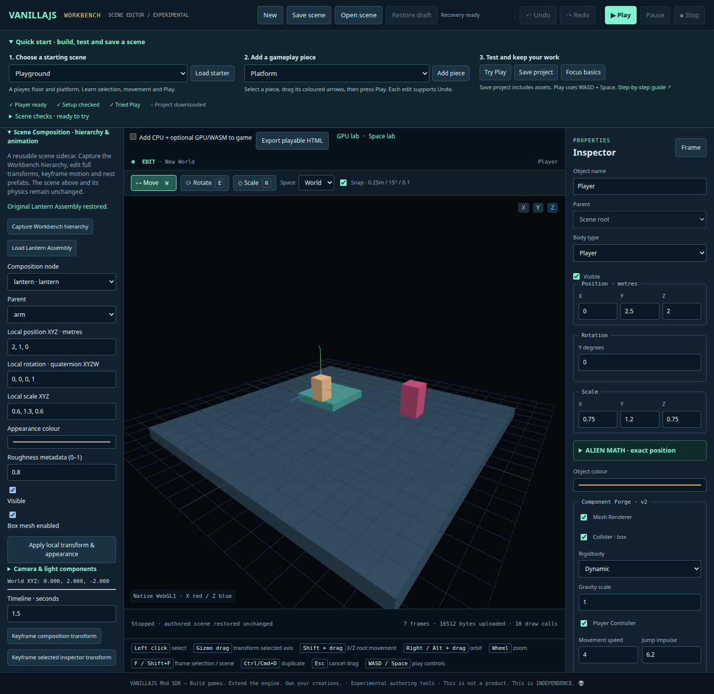
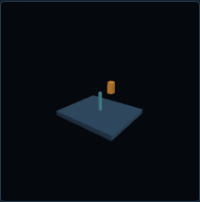

# SCENE-NARRATIVE-001 — execution record

Tested source: **`7bb8b5ba13932d4165e9610868155b7db1c67959`**. Reviewed base:
`7f2d5e62bb64aaf8c6ef7af8df678da9fe38412d`, published as v2.6.0 after PR #101.
Implementation bytes were frozen before the final required checks and committed
while the full browser run was in progress. The subsequent evidence-only commit
replaces this directory's placeholder and adds records; it changes no packaged
file, browser harness or policy. This is local execution evidence for owner
review, not a release or trusted-main CI execution receipt.

[Machine-readable record](execution.json) binds changed source files to SHA-256
and Git blob identities and records environment, commands, results and preservation
checks. [The package manifest](package-manifest.json) records every shipped file.

## Executed gates

| Command | Actual result | Record |
| --- | --- | --- |
| `node --test tests/*.test.js` | 1,026 passed; 0 failed/skipped | [TAP](node.tap) |
| `node scripts/check.js` | 442 JS files, 66 module contracts, two experiments; provenance/archive checks; 537 documentation links, 116 imports, ten workflows | [Log](source-check.log) |
| `node scripts/build.js` | 848 packaged files | [Log](build.log) |
| `node scripts/verify-offline.js` | 848 files, 5,359,311 bytes verified | [Record](offline.json) |
| `node scripts/browser-check.js` | All seven groups: home, render, play, worlds, research, donor, editor | [Full log](browser.log) |
| `git diff --check` | Passed | Recorded in execution JSON |
| Source-bound browser closure analysis | Zero unresolved issues in all seven groups | [Local analysis](cache-closures.json) |

Worker SHA-256: `f0ec86398ed85cda40085d3592967864591b5975b5b6a296c060fa36a29a5a96`.
Node v22.18.0, Python 3.14.4, Linux x64, pre-existing external Playwright 1.64.0
and Chromium 158.0.8127.18, headless SwiftShader. The actual assembled `dist/`
package was served under `/VANILLAJS/`, including nested lab URLs. No browser
was reinstalled and no owner-only hardware runner was dispatched. Hosted CI
provisions its own pinned browser and runs separately from this local evidence.

The complete Node run includes the scene and narrative unit tests and the cache,
package-provenance and receipt regressions. Both focused packaged browser runs
also passed before the full run: [scene](scene-focused.log),
[narrative](narrative-focused.log). Those focused runs used an earlier whole-package
worker identity; only later documentation changed the final runtime package.
The full run above uses the final package and final harnesses. No suite was skipped
or satisfied by a cached witness in that run.

## Actual new browser coverage

- Workbench hierarchy capture, actual affine WebGL geometry, transform editing,
  keyframes, seek/play/blur, undo/redo, nested prefab editing/rejection, camera
  behavior and ambient light controls. Scene Play locks composition editing.
- Scene sidecar export/reimport, literal imported names, invalid import rollback,
  invalid play-time rollback, native context loss/restoration and owned mesh
  disposal. Legacy scenes/projects and the original playable export remain covered
  by their existing scenarios in the full run.
- Narrative node, dialogue, choice, condition and effect authoring; original
  story's three endings; scene events that change actual GPU pixels; exact story
  and progress roundtrips, including restored scene pixels.
- Missing links, unsupported/malformed data, unsafe keys, inert HTML-like text,
  delayed-import cancellation, preserved accepted state and graphics allocation
  failure cleanup. Graph diagnostics retain their stated structural limits.
- Consecutive keyboard choice navigation, narrow 320 px layouts, real touch
  emulation, retained idle rendering and unavailable/lost graphics recovery.
- Fresh activated-worker clients navigated with networking disabled, verified
  service-worker responses and exercised offline authoring/preview. Narrative
  startup also recovered from a deliberately failed import.
- A **synthetic hostile older-worker fixture** retained poisoned unversioned
  modules while Narrative Foundry started using its content-derived namespace.
  This demonstrates isolation; it does not claim the fixture is a historical
  released worker. Existing Sprite/Weapon Feel startup checks also passed.
- All existing Game Labs, render/input checks, Creator Gateway, Workbench,
  Demoscene and research browser groups completed in the same full run.

## Observed failures and corrections

These attempts preceded the final candidate and are not PASS records.

1. The initial package build rejected a generic `document.createElement(tag)`
   factory as opaque runtime behavior. Fixed literal tag allowlists made the
   dependency closure inspectable. The existing analyzer guard was not loosened.
2. The first Narrative and Scene browser attempts tried editing controls inside
   collapsed advanced sections. The harnesses now click the real disclosure
   summaries first. No visibility assertions or test actions were bypassed.
   [Narrative failure](narrative-first-failure.log),
   [scene failure](scene-first-failure.log).
3. The second focused scene attempt hit `ERR_INTERNET_DISCONNECTED` when reloading
   its pre-installation client. Setup now checks the exact worker scope/activation,
   opens a fresh offline client and requires a successful service-worker response
   before testing offline authoring. This was a test-readiness correction, not a
   runner outage or a claimed runtime cache fix.
   [Failure](scene-offline-setup-failure.log).
4. Review found a repeatable story choice could exceed its bounded courage
   variable. Its eligibility condition now prevents that overflow. Keyboard
   focus now advances to the preview heading after replacing a choice, tested
   across consecutive Tab/Enter interactions.
5. Scene review added compact JSON fallback at the export byte limit, preserved
   admitted unit-quaternion bytes on roundtrip, retained the legacy 120-degree
   camera endpoint and made invalid play-time sampling transactional. Independent
   transform/inverse reference cases and rollback tests cover these boundaries.
6. Both adapters clean up partial renderer construction failures. Narrative
   progress reconstruction uses a bounded pure event replay, avoiding repeated
   history-prefix replay without dispatching any external effects. Maximum step
   and event limits have explicit acceptance and rejection tests.
7. Default-sandbox test attempts could not reliably complete the repository's
   child-process verification. Final required tests ran with the authorized
   local execution permission and exited successfully. No assertions were relaxed.

The final complete Node, source-check, package and all-group Chromium executions
passed on their first complete run of this frozen candidate. Earlier full Node
and source-check runs also passed; the logs above are the final executions.

## Preservation and identity boundaries

Every pre-existing module, formal proof, research file, archived execution record
and workflow is byte-identical to the reviewed base. The record also checks root
AGENTS, licences/notices, package metadata, historical README/roadmap archives,
Games2 integration policy, frozen reuse policy, receipt authority and worker
template. Catalogue changes add two modules and two recipes without rewriting
existing entries. The ALIEN MATH test change extends only its live synthetic
build fixture; archived capsules and proofs are untouched.

The live cache profile describes the new lab and refreshed content-derived module
namespaces. It also repairs pins left stale by the owner-reviewed v2.6.0 commit
`0446f35` for sprite pointer strokes and same-weapon ADS handling. Those sources
and their browser regressions are unchanged from released main. Unknown changes
still fail closed; one authenticated reviewed-main execution and source/package
checks remain required. Local analysis grants no trusted reuse authority.

Narrative state/choice replay is deterministic for exact validated story content.
Reachability is structural, not a proof that every condition is satisfiable.
Scene transforms use bounded Float64 arithmetic; endpoint admission does not
prove every intermediate animation sample. GPU images are not numerical proofs.
Full affine capture can differ from legacy decomposed transforms under rotated,
nonuniform parents. The original scene remains unchanged; project Save does not
include the separate sidecar. Directional lighting/roughness remain metadata.

No physical GPU/RTX, phone, controller, Firefox or Safari coverage, unmeasured
performance gain, release readiness or Games2 adoption is claimed. Games2 was
not modified. v2.8 and v2.9 remain proposed, separately gated work.

## Inspected visuals

Actual packaged Chromium screenshots, not concept renders. Narrow screenshots
show touch-emulated viewports and do not establish physical-device coverage.

[Narrative Foundry narrow viewport](narrative-foundry-mobile.png)

[Workbench composition narrow viewport](scene-composition-mobile.png)

[Milestone contracts](../../SCENE_NARRATIVE_001.md) ·
[Scene composition guide](../../SCENE_COMPOSITION.md) ·
[Narrative tutorial](../../NARRATIVE_FOUNDRY.md) ·
[Draft v2.7.0 notes](../../SCENE_NARRATIVE_2_7_0_DRAFT.md)
