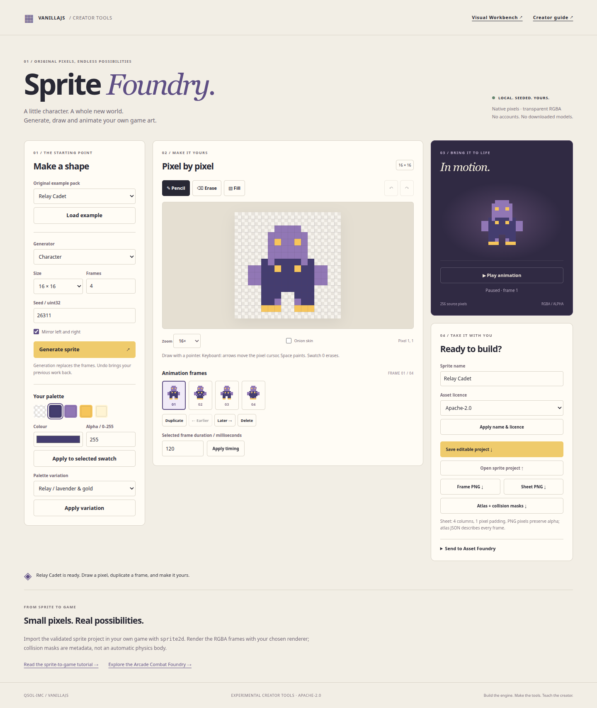
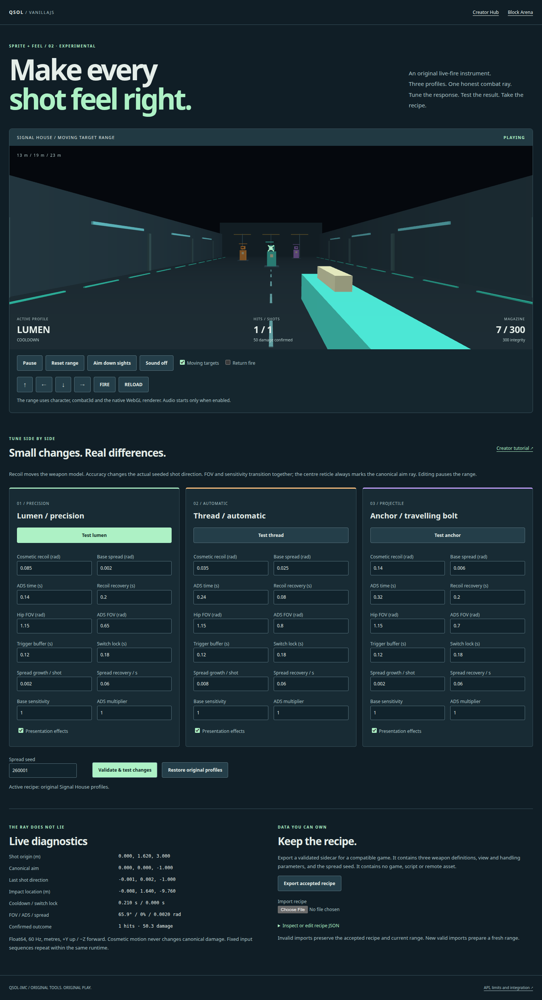

# SPRITE-FEEL-001 — execution record

Tested source: **`157e7d932cb98c7f458dbffbfb3df7c673774e24`**. Base:
`433f8c87a74ed145a612510ee388a7aacc1280f6` (published baseline v2.5.0).
The subsequent evidence-only commit adds this directory; it changes no packaged
runtime, test, policy or top-level guide. This is local execution evidence for
owner review, not a release or trusted-main CI execution receipt.

[Machine-readable receipt](execution.json) records source file SHA-256/Git blob
identities, package identity, environment, commands, outcomes and preservation
checks. [Package manifest](package-manifest.json) records every shipped file.

## Executed gates

| Command | Actual result | Record |
| --- | --- | --- |
| `node --test tests/*.test.js` | 1,001 passed; 0 failed/skipped | [TAP](node.tap) |
| `node scripts/check.js` | 429 JS files, 64 module contracts, two experiments; provenance/archive checks; 484 documentation links, 107 imports, eight workflows | [Log](source-check.log) |
| `node scripts/build.js` | 819 packaged files | [Log](build.log) |
| `node scripts/verify-offline.js` | 819 files, 5,076,509 bytes verified | [Receipt](offline.json) |
| `node scripts/browser-check.js` | All seven groups completed: home, render, play, worlds, research, donor, editor | [Full log](browser.log) |
| `git diff --check` | Passed | Recorded in execution receipt |
| Source-bound browser closure analysis | Zero unresolved issues in all seven groups | [Local analysis](cache-closures.json) |

Node v22.18.0, Python 3.14.4, Linux x64, existing external Playwright 1.64.0
and Chromium 158.0.8127.18, headless SwiftShader. Browser checks served the real
assembled `dist/` package under `/VANILLAJS/`, including nested lab URLs.
The checked-in hosted CI provisions its own pinned browser; these local results
do not stand in for that separate CI execution. No browser was reinstalled.

The first new focused checks also passed: ten sprite tests, twelve weapon tests,
and targeted packaged-browser scenarios. The full run above includes them and
all existing regression groups. No browser suite was skipped or satisfied with
a cached witness during this local full run.

## What the browser actually exercised

- Sprite generation matched exact module-produced pixel data. Pencil, erase,
  fill, keyboard cursor, touch painting, frame ordering/timing, preview, RGBA
  palettes, undo/redo and invalid-import rollback were exercised.
- Downloaded project, frame PNG, sheet and atlas/masks were inspected. The explicit
  opaque PNG bridge was imported through the real Workbench Asset Foundry.
- The weapon range produced actual moving-target hits with three distinct
  profiles, including delayed projectile impact, player movement, ADS/ray
  alignment, immediate relative mouse look, reload and switch/input cancellation.
- Recipe controls changed accepted parameters; invalid imports preserved state;
  exported recipes reimported. Tests covered real return-fire damage, retained
  geometry, audio-device failure, delayed audio-resume cancellation and graphics
  failure recovery.
- Both labs were exercised at 320 px with keyboard/touch/reduced-motion checks,
  installed the verified package and loaded/operated with networking disabled.
- Both guarded startups recovered after a failed module import. A separately
  served **synthetic hostile older-worker fixture** retained poisoned unversioned
  modules while the new content-derived namespace started correctly. The fixture
  is not a claim about bytes in a historical release.
- Existing Game Labs, editor, Creator Gateway, Demoscene and research browser
  checks completed in the same all-group run; see the full log for each result.

## Observed failures and corrections

These attempts preceded the final passing candidate and are not PASS receipts.

1. A temporary standalone sprite browser runner initially sliced the Pages prefix
   incorrectly. Correcting that test runner enabled actual packaged navigation.
2. The sprite test found horizontal overflow after adding timeline frames at
   320 px. Constraining grid children with zero minimum widths fixed it.
   [Failure log](sprite-layout-failure.log); the original narrow-layout assertion
   remains and passes.
3. Independent review found array-subclass admission and palette/cursor restoration
   edge cases. Strict array descriptors/prototypes and restored edit bounds now
   have regression coverage. Seeded generation was finalized before freezing its
   implementation-v1 pixel fixture; published implementations were not changed.
4. Weapon review found fractional cooldown/reload remainders could be treated as
   eligible before the existing WeaponTimer accepted them. The adapter now matches
   the canonical cooldown tolerance and requires exactly zero reload remainder;
   real-Combat3D regressions preserve the buffered shot and seeded spread state.
5. The first weapon mouse test observed Pointer Lock ownership before the actual
   application lock callback. It now waits for that callback, then still asserts
   that relative input changes aim synchronously without a physics tick.
6. Delayed audio resume followed by blur could leave button feedback stale.
   Immediate preference feedback and cancellation generations fix the race; a
   native AudioContext regression and device-failure check passed.
7. The first full Node run found missing new-lab files in the **live synthetic
   capsule-build fixture** and a reused homepage FPS class. The fixture now models
   both starts; no archived capsule/proof was altered. [Initial TAP, losslessly compressed](initial-node-failures.tap.gz).
8. The first full browser run found the replacement class also collided with the
   Interaction Lab's existing unique selector. The new link now has its own
   `weapon-feel-link` class. The existing strict selector was preserved.
   [Failure log](initial-browser-failure.log).
9. One local shell was interrupted with exit 143 after Node TAP reported all tests
   passing. Its cause was not established. Separate final Node and source-check
   executions both exited 0; the attached logs are those completed executions.
   An independent sandbox-blocked cache-test attempt was separately cancelled;
   the final full Node suite includes those cache tests successfully.

## Preservation and identity boundaries

The execution receipt compares every pre-existing module, formal proof, research
file, archived execution-evidence file and workflow against the reviewed base.
All are unchanged. Existing licence/notices, root policy, frozen cache policy,
receipt authority, worker template, historical README/roadmap archives and
package metadata are also unchanged. Live synthetic fixtures and additive
catalogue/package registrations changed to describe the new functionality.

The live cache profile records reviewed new code and the relocated, byte-identical
editor namespace copies. Unknown code still fails closed; source/package
provenance and one authenticated main execution remain required. Local closure
analysis is explicitly untrusted and grants no reuse authority.

Sprite recipe/implementation/seed/palette identity proves source pixels/RGBA,
not browser-encoded PNG byte identity. Gameplay uses bounded same-runtime Float64
with explicit input order and tick assignment. Cosmetic recoil cannot change
canonical combat direction. GPU pixel output is not a numerical proof.

No physical GPU/RTX, phone, controller, Firefox or Safari coverage, universal
performance improvement, release readiness or Games2 adoption is claimed.
Games2 was not modified. v2.7–v2.9 remain proposed, separately reviewed work.

## Inspected visuals

Actual packaged Chromium screenshots, not concept renders. Mobile images show
320 px touch-emulated layouts; they do not establish physical-device support.

[Sprite Foundry narrow viewport](sprite-foundry-mobile.png)

[Weapon Feel Lab narrow viewport](weapon-feel-mobile.png)

[Milestone contracts](../../SPRITE_FEEL_001.md) ·
[AFTER//ZERO donor audit](../../AFTER_ZERO_GAME_FEEL_AUDIT.md) ·
[Draft v2.6.0 notes](../../SPRITE_FEEL_2_6_0_DRAFT.md)
