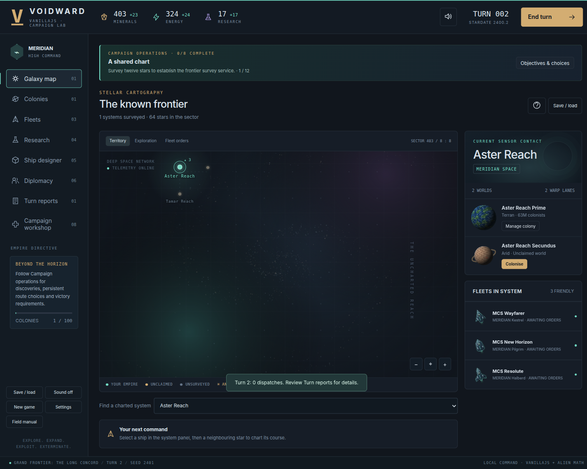
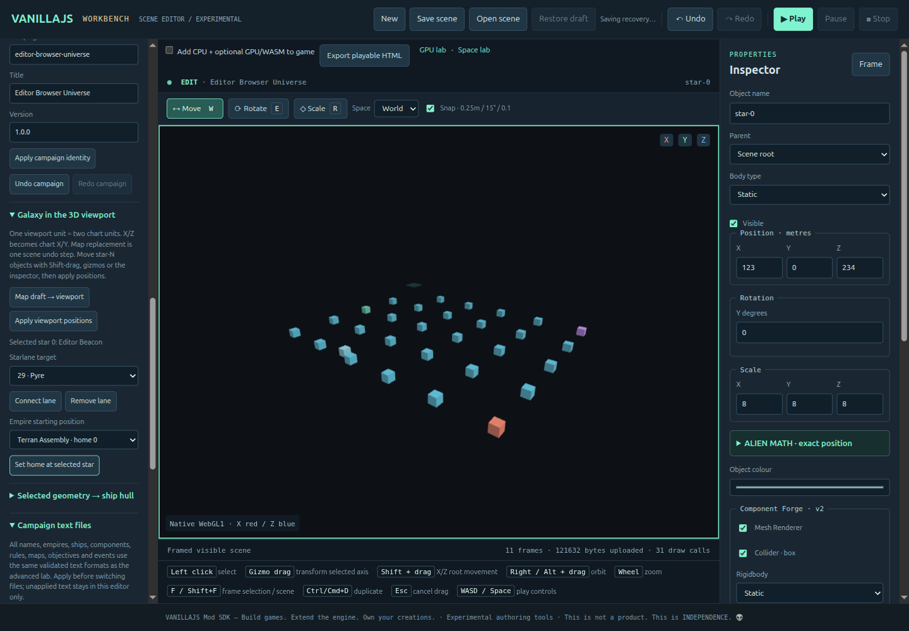

# Executed VOIDWARD port evidence

Baseline: VANILLAJS `5a91cd4cc7251c485eaf2fc80d5227a20571fd8c`.
Donor: 4XGAMES PR #2, `030859385ac8929e066702ef8af0518663480653`.
Environment: Linux x64, Node 22, Chrome 156, externally installed Playwright.
The owner explicitly authorised unattended local CPU/GPU browser tests and reruns.

- [Baseline](baseline.json): 671 Node tests, source/package/offline verification,
  real Ternary Reach controls and original editor screenshot.
- [Expanded Node and archive checks](node-validation.json): 743 tests, donor/native
  hashes and archived evidence checks pass.
- [Owner browser run](owner-browser.json): original Ternary Reach, existing editor,
  VOIDWARD campaigns and editor campaign bridge all pass.
- [Campaign details](campaign-browser.json): 15 checks, all five campaigns and nine
  playable campaign/empire choices, zero page errors, HTTP failures or external
  runtime requests. Exact image comparisons cover three planet palettes and two
  map sizes. A 2,429,209-byte synthetic save survives actual UI import/export/reimport.
- [GPU assessment](gpu-assessment.json): hardware renderer with Canvas2D and
  compositing enabled; dedicated game traces show GPU raster and swap events.
  CPU raster events also occur. This establishes hardware participation, not
  exclusive GPU execution or a speedup claim.
- [Failure retained](failure-history.json): a pre-existing browser test assumed
  timed keystrokes formed one undo transaction. One text insertion makes that
  assertion independent of timing; the full rerun passed.

Audio produced a measured nonzero signal on a node connected to the actual audio
destination (peak approximately 0.02845). Independent volume preferences and
reload preservation pass. Human listening and speaker output were not assessed.
Touch is browser emulation; no physical phone or additional browser engine was
tested. Longer campaign completion witnesses are legal-command Node runs, not
claims of full manual playthroughs.

The small/large game observations use Machine Dawn and Grand Frontier. Five
click-to-second-animation-frame samples were 31.6–32.0 ms and 31.0–31.8 ms
respectively. These include simulation, persistence, DOM work and frame scheduling;
they are not input-device latency or pure engine timing. The detailed rendering
samples, DOM counts, save sizes and approximate heap observations are in the
campaign receipt. No new optimisation or speedup is claimed by this integration.

## Review the actual output




[Narrow campaign](campaign-mobile.png) · [320px editor](editor-mobile.png) ·
[Original Ternary Reach](baseline-ternary.png) · [Original editor](baseline-editor.png).

The browser created and round-tripped these inert artifacts through actual controls:

- [Editor-created campaign](editor-created-campaign.json)
- [Hull and complete source declarations](editor-hull-bundle.json)
- [Game-workshop-created campaign](workshop-created-campaign.json)

Import the campaign JSON into the editor or VOIDWARD workshop. Import the hull
bundle through VOIDWARD's Workbench hull importer, not the native scene importer.
The editor artifact deliberately includes owner-local primitive provenance and
a test mesh declaring MIT; these records demonstrate retention, not a transfer of
rights to unrelated assets.

## Reproduce

From the repository root, with the existing external Playwright installation:

```sh
node --test tests/*.test.js
node scripts/check.js
node scripts/build.js
node scripts/verify-offline.js
node scripts/browser-check.js --suites=worlds,editor
```

The CI browser command uses the existing software rendering configuration.
For the separate headed owner test, obtain an explicit desktop handover first:

```sh
VANILLAJS_OWNER_PROCEED=1 \
PLAYWRIGHT_MODULE=/path/to/existing/playwright \
BROWSER_EXECUTABLE=/path/to/existing/chrome \
node scripts/voidward-owner-browser.mjs
```

It serves the packaged build under `/VANILLAJS/`, controls only a dedicated browser,
and closes its browser and server in `finally`. It never triggers the personal
runner. The completed run left zero owned browser processes.

Public JSON contains portable excerpts with coarse environment information.
Raw device diagnostics, full GPU traces, profiles and local home paths are excluded.
The [artifact inventory](artifact-inventory.json) binds the portable results and
byte-identical screenshots/creator files; raw trace hashes remain in the GPU
assessment for local comparison. The initial sandbox's child-process restrictions
were resolved through authorised execution; no failed check was relabelled PASS.
