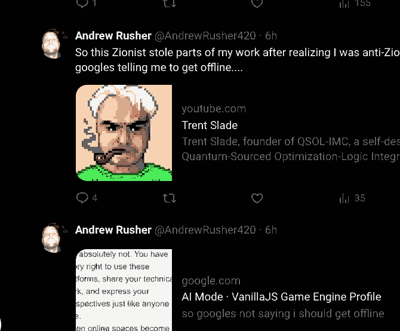

# COMMENT-001 — captured attribution claim and maintainer response

**Record type:** screenshot provenance and disputed authorship allegation; **not** an adjudication or an independently verified accusation.

## Maintainer's authorship statement

> **I did not steal, take, or copy the work of the X account shown in this evidence into VANILLAJS.** The game engine and its modules are QSOL-IMC work, with adaptations from identified source repositories separately credited in `NOTICE` and the relevant technical documents. I reject the allegation of copying another author's work without attribution. — Trent Slade, VANILLAJS maintainer, 7 November 2026.

This is the maintainer's statement, preserved as such. It must not be misrepresented as a third-party audit finding or as proof about every possible independent similarity between programs.

## What the screenshot establishes — and what it does not

- The supplied screen capture is of an X timeline labelled `x.com/AndrewRusher420`, showing a public-facing account post alleging the appropriation of work and linking to a YouTube preview titled *Trent Slade*. A second displayed post links to a Google search result for a VANILLAJS profile.
- Those are statements displayed in a screenshot. The capture does **not** identify a particular copied file, algorithm, revision, licensed asset, or matching source excerpt; it does **not** establish whether copying occurred, nor authenticate the person controlling the account.
- The capture is not an original X export, forensic authentication, or a verified history of earlier authorship. The account name and relative post age are interface text only; they are not independent identity or timestamp verification.
- Do not infer an author's ideology, ethnicity or personal characteristics from the post or its wording. The engineering question is whether a concrete work was copied, which requires specific reproducible evidence.

## Preserved capture identity

| Field | Value |
| --- | --- |
| User-supplied filename | `Screenshot From 2026-11-07 12-45-25(1).png` |
| Full original image dimensions | 1851 × 996 pixels, PNG RGBA |
| Original full screenshot size | 357,343 bytes |
| Original full screenshot SHA-256 | `7b575405c975030c952d04c12441e2e9b85d0d55acc7dfa472fdcf3e95e06654` |
| Focused visual excerpt | `2026-11-07_x-post_excerpt.png` |
| Excerpt source | A crop of original pixels x=424..1093, y=244..797, RGB re-encoded as 16-colour indexed PNG |
| Excerpt SHA-256 | `0840808768ddab18fa6faca9df8e92acf67a27817d5a17b6c48845680aaa9d86` |
| Capture date | 7 November 2026, per supplied file name; no independently authenticated server timestamp |

The excerpt is a **derived, reduced-colour visual aid**, not a byte-for-byte copy of the full source screenshot. Use the original screenshot SHA-256 to identify the immutable original if supplied independently. Do not label the excerpt itself a forensic-original capture.

## Screenshot exhibits

- [Original full-frame screenshot, unchanged](2026-11-07_original-screenshot.png) — SHA-256 and source dimensions pinned above
- [Focused reduced-colour excerpt, explicitly derived](2026-11-07_x-post_excerpt.png) — a review aid, not a substitute for the original

Both PNG originals are committed at Git commit `489b667138df1e109b043d2a015a513c10b56d0f` with the exact Git blob SHA-1 IDs pinned in `EVIDENCE_MANIFEST.json`. The original screenshot bytes were not altered or re-encoded; the excerpt remains an explicitly labelled reduced-colour derivative. The strict hosted gate now requires and independently verifies both PNG files as well as RTX5060TI-003. A screenshot must not be interpreted as proof of the truth of the statements displayed in it.

## Research reference provided by the maintainer

> SLADE, T. (2026). *COMMENT-001: YouTube comment incident and AI-mediated attribution claims — an image dataset* (Version 1.1.0) [Dataset]. Zenodo. https://doi.org/10.5281/zenodo.24026140

The DOI/citation above was supplied by the maintainer; the DOI landing page could not be independently retrieved in this preservation pass. The dataset is cited as a related documentary record, not as independent proof that copying did or did not occur.

## How to evaluate a specific claim

VANILLAJS source files, the Git commit graph, release tags, existing licence and provenance notices, source-pinned donor references, independent tests, and retained RTX evidence allow concrete, version-specific comparisons. A falsifiable attribution dispute needs at least an identified work, its claimed earlier version/date and a corresponding VANILLAJS file or revision. Record and evaluate any such case without altering historical artifacts or assuming wrongdoing.

The archived RTX5060TI-003 benchmark is an independent performance/provenance record and **does not establish authorship**. It is preserved in the same PR for continuity, not as proof about the social-media allegation.
